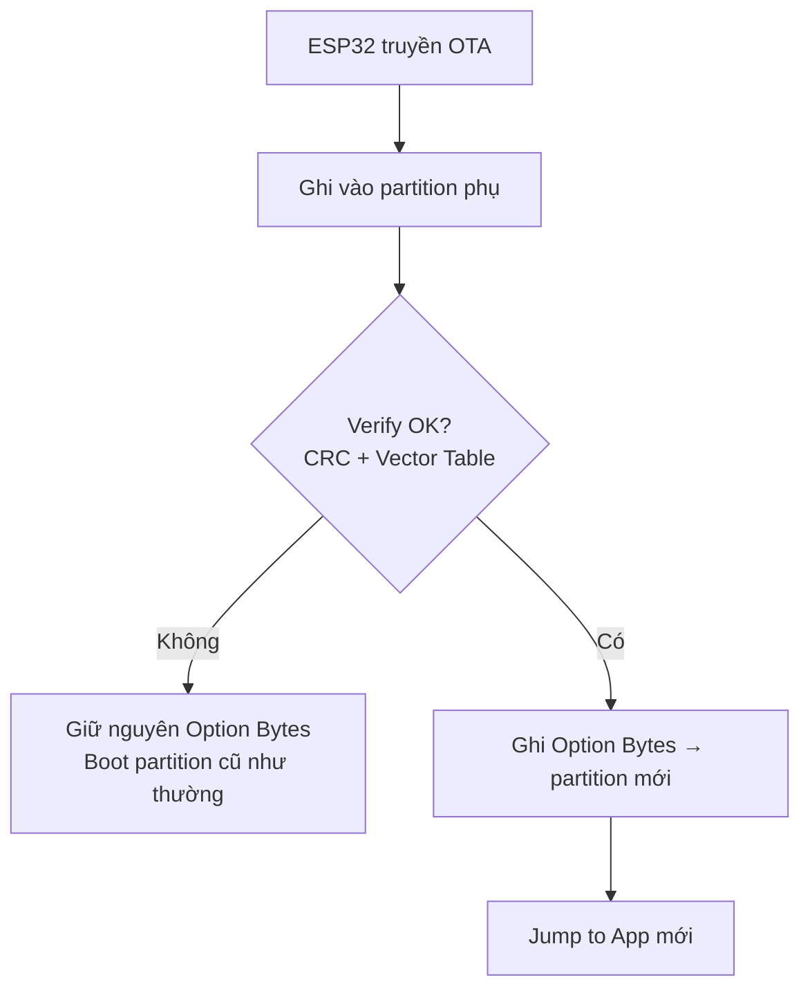

# Option Bytes — Quản lý Phân vùng Boot (STM32F103)

Option Bytes là vùng Flash phi bốc hơi đặc biệt, độc lập với 128KB Flash chính, không mất khi reset hay rút nguồn.

---

## 1. Thanh ghi sử dụng

| Thanh ghi | Địa chỉ | Mục đích |
|:----------|:-------:|:---------|
| **User Data 0** | `0x1FFFF804` | Lưu ID partition đang active (`0x01` = App1, `0x02` = App2) |

> [!NOTE]
> Dự án chỉ dùng `Data0`. `Data1` không sử dụng.

---

## 2. Đọc Active Partition

```c
uint8_t active = *(volatile uint8_t *)0x1FFFF804;
if (active != 1 && active != 2) active = 1;  // 0xFF (mới) → mặc định App1
```

Xem implementation: [`Flash_GetActivePartition()`](../STM32/Bootloader/Src/flash.c)

---

## 3. Ghi Active Partition

```c
FLASH_Unlock();
FLASH_ClearFlag(FLASH_FLAG_EOP | FLASH_FLAG_PGERR | FLASH_FLAG_WRPRTERR);
FLASH_EraseOptionBytes();
FLASH_ProgramOptionByteData(0x1FFFF804, partition_id);  // 0x01 hoặc 0x02
FLASH_Lock();
```

> [!IMPORTANT]
> `FLASH_EraseOptionBytes()` không tự reset chip (khác `FLASH_OB_Launch()` trong HAL). Bootloader dùng SPL — ghi xong vẫn chạy tiếp bình thường trước khi jump.

Xem implementation: [`Flash_SetActivePartition()`](../STM32/Bootloader/Src/flash.c)

---

## 4. Cơ chế Atomic Switching



Option Bytes chỉ được thay đổi **sau khi** toàn bộ firmware mới đã được xác thực. Mất nguồn ở bất kỳ bước nào trước đó → vẫn boot firmware cũ ổn định.
