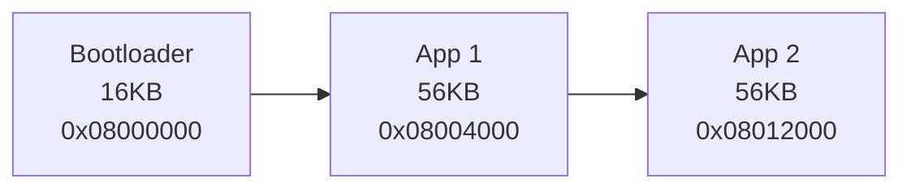
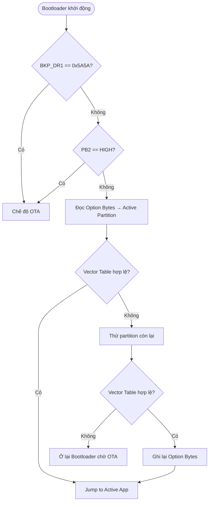

# Flash Layout & Cấu hình Dự án OTA (STM32F103 — 128KB)

---

## 1. Phân vùng Flash

Tổng 128KB, page size 1KB, địa chỉ `0x08000000..0x0801FFFF`.

| Phân vùng | Origin | End | Size | Pages |
|:----------|:------:|:---:|:----:|:-----:|
| Bootloader | `0x08000000` | `0x08003FFF` | 16KB | 16 |
| App 1      | `0x08004000` | `0x08011FFF` | 56KB | 56 |
| App 2      | `0x08012000` | `0x0801FFFF` | 56KB | 56 |



---

## 2. Cấu hình Linker Script (`.ld`)

#### Bootloader
```ld
MEMORY {
  RAM   (xrw) : ORIGIN = 0x20000000, LENGTH = 20K
  FLASH (rx)  : ORIGIN = 0x08000000, LENGTH = 16K
}
```

#### App 1
```ld
MEMORY {
  RAM   (xrw) : ORIGIN = 0x20000000, LENGTH = 20K
  FLASH (rx)  : ORIGIN = 0x08004000, LENGTH = 56K
}
```

#### App 2
```ld
MEMORY {
  RAM   (xrw) : ORIGIN = 0x20000000, LENGTH = 20K
  FLASH (rx)  : ORIGIN = 0x08012000, LENGTH = 56K
}
```

---

## 3. Vector Table Offset (VTOR)

Mỗi App phải dời VTOR trong `system_stm32f10x.c`:

```c
// App 1
#define VECT_TAB_OFFSET  0x4000   // +16KB từ FLASH_BASE

// App 2
#define VECT_TAB_OFFSET  0x12000  // +72KB từ FLASH_BASE
```

> [!NOTE]
> Bootloader giữ `VECT_TAB_OFFSET = 0x0` (mặc định).

---

## 4. Flash target trong Makefile

```makefile
# Bootloader
st-flash write $(BUILD_DIR)/$(TARGET).bin 0x08000000

# App 1
st-flash write $(BUILD_DIR)/$(TARGET).bin 0x08004000

# App 2
st-flash write $(BUILD_DIR)/$(TARGET).bin 0x08012000
```

---

## 5. Quản lý Active Partition — Option Bytes

Thanh ghi **User Data 0** tại `0x1FFFF804` (non-volatile, không mất khi reset):
- `0x01` → boot App 1
- `0x02` → boot App 2
- Giá trị khác (ví dụ `0xFF` lần đầu) → mặc định App 1

Chỉ ghi Option Bytes **sau khi firmware mới đã verify toàn bộ** (CRC + Vector Table). Đây là cơ chế atomic switching — đảm bảo không bao giờ trỏ vào firmware lỗi.

Xem chi tiết API: [`flash.c`](../STM32/Bootloader/Src/flash.c) — `Flash_GetActivePartition()`, `Flash_SetActivePartition()`.

---

## 6. Cơ chế Rollback


