# Tổng quan
Dự án: Thiết kế mô hình Automotive Gateway cho xe điều khiển phân tán: Tích hợp kiến trúc cập nhật phần mềm không dây tự phục hồi (OTA Dual-Bank Rollback) qua mạng CAN Bus 
- Xe điều khiển qua Wifi bằng ESP32 + STM32
- Tích hợp chức năng Update Firmware cho STM32 qua Wifi dùng ESP32
- Sử dụng giao thức CAN để giao tiếp trên Xe
# Các đầu việc
- Dự án bao gồm các Module theo Phần cứng:
	- STM32
		- Bootloader
		- App - Điều khiển xe
	- ESP32
		- OTA Driver
		- Web điều khiển

| Phần cứng | Phần mềm          | Nguời phụ trách |
| --------- | ----------------- | --------------- |
| STM32     | Bootloader        | Trung           |
|           | App điều khiển xe | Long            |
| ESP32     | OTA Driver        | Trung           |
|           | Web điều khiển    | Long            |
- Báo cáo:
	- A viết: Kiến trúc Bootloader, Flash layout, giao thức OTA, Makefile
	- B viết: Kiến trúc App, motor/servo driver, sơ đồ phần cứng
	- Cả 2: Giao thức CAN, test cases, kết quả
### Trung
- Làm việc trên Linux + Makefile trên tổng dự án (OTA + Ghép nối) 
- [x] Setup GIT STM(Bootloader, App1, App2, AppKeil), ESP(App_OTA, App_Control), Thêm 1file quản lý dự án
- [x] Dạy Long dùng Git
- [ ] Học viết Makefile riêng

- [ ] Học CAN, dạy lại Long
- [x] Code lại OTA theo CAN, cấu hình Frame, lệnh,...
- [ ] Phân tầng code theo các lớp

- [x] Làm cái Web điều phối OTA
- [ ] Ghép code
### Long
- Làm việc trên Keilc luôn vì chỉ code AppKeil.
- [x] Học dùng Git
- [x] Học Timer, PWM, UART để điều khiển động cơ bằng STM
- [ ] Thiết kế sơ đồ nối dây

- [ ] Làm xe chạy được theo từng lệnh giữa STM và ESP
- [ ] Đổi qua dùng CAN để giao tiếp 

- [ ] Làm cái Web điều khiển bằng ESP
# Notes
- Cần thêm:
	- Module cấp nguồn cho STM, ESP : 1 LM2596 = 30.000VND
	- Cần 2 Module SN65HVD230 cho CAN = 2 x 30.000VND = 60.000VND
	- 1 STM32F103C8T6 - Bluepill, 1 mạch nạp ST-Link = 80.000VND
	- Total = 170.000VND
- Phần cứng đã có:
	- Moto Shield L298 cho Arduino
- Cần học dùng PWM
- Dùng Git share code
# Có thể làm thêm
- Áp dụng phương pháp Blackbox test để kiểm chứng luồng cập nhật OTA: tạo các test case cố tình gửi sai mã CRC, ngắt kết nối CAN giữa chừng hoặc ngắt nguồn để đánh giá độ tin cậy của cơ chế Rollback.
- MQTT
- 4G
# Các tiến trình
- Xe: Thay thế Arduino bằng STM32 + ESP32 và có thể điều khiển qua wifi
	- Thiết kế sơ đồ nối giữa STM32 và Hệ thống xe
	- Sử dụng STM32 để điều khiển xe
		- Học và dùng PWM
	- Tích hợp thêm ESP để điều khiển qua Wifi
- Hệ thống OTA: Giao tiếp STM32 và ESP32 bằng CAN, thực hiện OTA. 
	- Giao tiếp CAN STM32 và ESP32
	- Code lại OTA theo CAN và quy ước
- Tổng thể:
	- Làm Makefile cho STM32
- Ghép lại

# Quy hoạch ID CAN (Chuẩn 11-bit Standard ID)

### Cấu trúc 11-bit CAN ID
```
Bit:  [10 : 9]  |  [8 : 6]  |  [5 : 0]
      Luồng tin |  Mã CMD   |  STT Gói tin trong Chunk
```
- **Bit [10:9] - Phân luồng dữ liệu (Routing):**
  - `00`: Luồng Control (Lái xe, động cơ, cảm biến) $\rightarrow$ Cấu hình lọc vào **FIFO0**.
  - `11`: Luồng OTA (Cập nhật firmware) $\rightarrow$ Cấu hình lọc vào **FIFO1**.
- **Bit [8:6] - Mã lệnh (Command ID):**
  - `000` đến `111` định danh loại bản tin trong luồng OTA.
- **Bit [5:0] - STT gói tin (Packet Index):**
  - Chạy từ `0` đến `31` cho Chunk 256 bytes (tối đa 63 gói). Giữ nguyên trọn vẹn 8 bytes Payload cho firmware.

### Bảng tra cứu CAN ID OTA chi tiết

| Tên Frame | CAN ID (Bin) | CAN ID (Hex) | Hướng truyền | DLC | Payload Data | Chức năng chi tiết |
| :--- | :---: | :---: | :---: | :---: | :--- | :--- |
| **`ID_REQ_BOOT`** | `0b11000000000` | `0x600` | ESP $\rightarrow$ STM (App) | 4 | `[0xDE, 0xAD, 0xBE, 0xEF]` (Security Key) | Yêu cầu App dừng xe, set cờ `BKP_DR1 = 0x5A5A` và Soft-Reset vào Bootloader. |
| **`ID_QUERY_APP`** | `0b11000100000` | `0x620` | ESP $\rightarrow$ STM (App/Boot) | 1 | `[0x55]` (Query Request) | ESP32 truy vấn phân vùng App đang Active (`App 1` hay `App 2`). |
| **`ID_START_OTA`** | `0b11001000000` | `0x640` | ESP $\rightarrow$ STM (Boot) | 1 | `Byte 0`: `App_ID` (`0x01` hoặc `0x02`) | Bắt đầu phiên OTA, yêu cầu xóa sạch Flash phân vùng đích. |
| **`ID_START_FILE`** | `0b11010000000` | `0x680` | ESP $\rightarrow$ STM (Boot) | 6 | `Byte 0..3`: Total Size (4B)<br>`Byte 4..5`: Global CRC16 (2B) | Khai báo kích thước toàn file và mã checksum tổng. |
| **`ID_START_CHUNK`** | `0b11011000000` | `0x6C0` | ESP $\rightarrow$ STM (Boot) | 2 | `Byte 0..1`: Chunk Length (thường là 256 bytes) | Báo bắt đầu 1 Chunk, STM32 reset bộ đệm và `expected_packet_idx = 0`. |
| **`ID_DATA_CHUNK`** | `0b11100000000` | `0x700..0x71F` | ESP $\rightarrow$ STM (Boot) | 1..8 | `Byte 0..7`: Dữ liệu firmware thô | Truyền dữ liệu Chunk. STT gói nhúng vào 6 bit thấp ID (`0x700 | STT`). |
| **`ID_END_CHUNK`** | `0b11101000000` | `0x740` | ESP $\rightarrow$ STM (Boot) | 2 | `Byte 0..1`: Chunk CRC16 (2B) | Báo kết thúc Chunk để STM32 kiểm tra CRC và ghi Flash. |
| **`ID_END_FILE`** | `0b11110000000` | `0x780` | ESP $\rightarrow$ STM (Boot) | 2 | `Byte 0..1`: Global CRC16 (2B) | Báo kết thúc File để STM32 verify toàn Flash & đổi Option Bytes. |
| **`ID_RESPONSE`** | `0b11111000000` | `0x7C0` | STM $\rightarrow$ ESP | 1..2 | `Byte 0`: `0x00` (ACK) / `0x01` (NACK)<br>`Byte 1`: App ID (khi phản hồi QUERY) | Phản hồi xác nhận trạng thái hoặc kết quả truy vấn App từ STM32 về ESP32. |

---

# Quy trình CAN OTA hoàn chỉnh

```mermaid
sequenceDiagram
    autonumber
    participant ESP as ESP32 (Gateway / Master)
    participant App as STM32 (Application)
    participant Boot as STM32 (Bootloader)

    rect rgb(30, 40, 50)
    note right of ESP: PHA 0: KÍCH HOẠT VÀO BOOTLOADER (SOFTWARE TRIGGER QUA CAN)
    ESP->>App: ID 0x600: REQ_BOOT [Security Key: 0xDEADBEEF]
    Note over App: 1. Đưa xe về an toàn (Dừng motor)<br/>2. Ghi 0x5A5A vào BKP_DR1 (Backup Reg)<br/>3. Kích hoạt NVIC_SystemReset()
    App-->>ESP: ID 0x7C0: ACK (0x00)
    Note over Boot: STM32 khởi động lại:<br/>Đọc BKP_DR1 == 0x5A5A -> Ở lại Bootloader chờ OTA
    end

    rect rgb(40, 40, 60)
    note right of ESP: PHA 1: KHỞI TẠO & XÓA FLASH
    ESP->>Boot: ID 0x640: START_OTA [App_ID: 0x01 / 0x02]
    Note over Boot: Xóa các Page Flash phân vùng đích (1 - 2s)
    Boot-->>ESP: ID 0x7C0: ACK (Đã xóa Flash)
    
    ESP->>Boot: ID 0x680: START_FILE [Total Size (4B), Global CRC16 (2B)]
    Boot-->>ESP: ID 0x7C0: ACK (Sẵn sàng nhận dữ liệu)
    end

    rect rgb(40, 60, 40)
    note right of ESP: PHA 2: TRUYỀN CHUNK 0 (NORMAL PATH - 256 BYTES)
    ESP->>Boot: ID 0x6C0: START_CHUNK [Length: 256 Bytes]
    Note over Boot: Reset buffer RAM, đặt expected_packet_idx = 0
    
    loop Truyền liên tục 32 gói (Burst cách nhau 3ms, không chờ ACK lẻ)
        ESP->>Boot: ID 0x700: DATA_CHUNK [STT: 0] + 8 bytes data
        ESP->>Boot: ID 0x701: DATA_CHUNK [STT: 1] + 8 bytes data
        Note over ESP,Boot: ... Tiếp tục truyền tuần tự đến gói 31 ...
        ESP->>Boot: ID 0x71F: DATA_CHUNK [STT: 31] + 8 bytes data
    end
    
    ESP->>Boot: ID 0x740: END_CHUNK [Chunk CRC16 (2B)]
    Note over Boot: 1. Kiểm tra đủ 32 gói & khớp Chunk CRC16<br/>2. Ghi 256 bytes vào Flash & verify
    Boot-->>ESP: ID 0x7C0: ACK (Chunk 0 OK)
    end

    rect rgb(60, 40, 40)
    note right of ESP: PHA 3: TRUYỀN CHUNK 1 (XỬ LÝ LỖI MẤT/SAI GÓI & RETRANSMIT)
    ESP->>Boot: ID 0x6C0: START_CHUNK [Length: 256 Bytes]
    ESP->>Boot: ID 0x700: DATA_CHUNK [STT: 0] + 8 bytes data
    Note over ESP,Boot: ❌ Nhiễu CAN làm mất gói STT #1
    ESP->>Boot: ID 0x702: DATA_CHUNK [STT: 2] + 8 bytes data
    
    Note over Boot: Phát hiện sai STT (Kỳ vọng #1, nhận #2)<br/>1. Đánh dấu chunk_seq_error = 1<br/>2. Gửi ngay NACK sớm
    Boot-->>ESP: ID 0x7C0: NACK (Lỗi sai STT gói)
    
    Note over ESP: ESP nhận NACK sớm -> Ngắt ngay các gói còn lại<br/>Tự động truyền lại toàn bộ Chunk 1 (Retry attempt 2/3)
    ESP->>Boot: ID 0x6C0: START_CHUNK [Length: 256 Bytes]
    Note over ESP,Boot: ... Truyền lại đủ 32 gói từ STT #0 đến #31 ...
    ESP->>Boot: ID 0x740: END_CHUNK [Chunk CRC16 (2B)]
    Note over Boot: Khớp CRC16 -> Ghi vào Flash
    Boot-->>ESP: ID 0x7C0: ACK (Chunk 1 OK)
    end

    rect rgb(40, 40, 60)
    note right of ESP: PHA 4: KẾT THÚC OTA & DUAL-BANK ROLLBACK VERIFY
    ESP->>Boot: ID 0x780: END_FILE [Global CRC16 (2B)]
    Note over Boot: 1. Đọc lại Flash tính Global CRC16 (Khớp 100%)<br/>2. Kiểm tra Vector Table (MSP & Reset_Handler hợp lệ)<br/>3. Cập nhật Option Bytes sang phân vùng Active mới
    Boot-->>ESP: ID 0x7C0: ACK (Hoàn tất 100%)
    Note over Boot: Delay 20ms -> Jump sang Application mới!
    end
```



---

# Cơ chế An toàn & Tự phục hồi (Fail-safe / Rollback)

1. **Bảo vệ mất nguồn giữa chừng (Power-Loss Protection):**
   - Phân vùng đang chạy (Active Bank) được lưu trong **Option Bytes** phần cứng.
   - Khi đang nạp vào phân vùng dự phòng mà bị rút nguồn hoặc ngắt kết nối CAN giữa chừng: Option Bytes vẫn trỏ về phân vùng cũ $\rightarrow$ Khởi động lại xe vẫn chạy bình thường trên bản firmware cũ, không bao giờ bị tê liệt (Fail-safe).
2. **Bảo vệ mã lỗi / Hỏng dữ liệu (Data Integrity):**
   - Hai tầng kiểm tra CRC:
     - **Tầng Chunk:** CRC16-Modbus cho từng 256 bytes (chống lỗi truyền dẫn từng khối).
     - **Tầng File:** Global CRC16-Modbus quét toàn bộ Flash sau khi nạp xong.
   - Kiểm tra Vector Table: MSP phải nằm trong vùng SRAM (`0x20000000 - 0x20005000`) và Reset_Handler phải trỏ đúng vào địa chỉ Flash của phân vùng đó. Nếu sai, Bootloader tự động xóa phân vùng lỗi và Rollback về phân vùng còn lại.
3. **Cơ chế Jumper cứu hộ bàn Lab (Recovery Mode):**
   - Chân `PB2` (Jumper BOOT1 trên board Blue Pill) vẫn được giữ làm công tắc phần cứng cứu hộ. Nếu nhà phát triển lỡ nạp bản App bị treo cứng không nhận ngắt CAN, chỉ cần gạt jumper PB2 lên `HIGH` (3V3) để ép chip vào Bootloader cứu hộ.