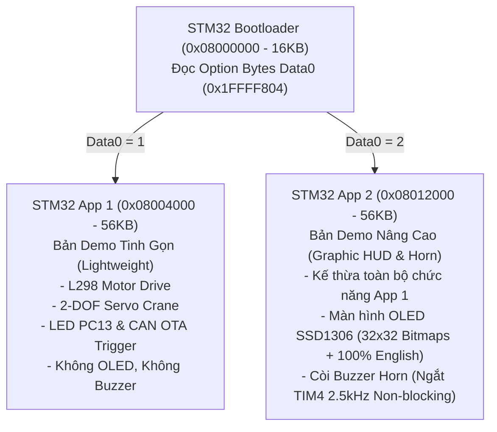

# Tổng quan Dự Án
Dự án: **Automotive Gateway — OTA Dual-Bank Rollback qua CAN Bus**  
Hệ thống xe điều khiển phân tán gồm Gateway ESP32 (Wi-Fi/Web Server/MicroSD) và ECU STM32F103 (Cầu H L298, Servo 2-DOF, Màn hình OLED SSD1306, Còi Buzzer), cập nhật firmware không dây an toàn qua mạng CAN Bus 500 kbps.

---

# Phân công Nhiệm vụ

| Phần cứng | Phân hệ Phần mềm | Người phụ trách | Trạng thái |
| :--- | :--- | :--- | :---: |
| **STM32** | Bootloader Dual-Bank & Cơ chế Atomic Rollback | Trung | **Hoàn thành** |
| | Application 1: Demo cơ bản tinh gọn (Motor + 2-DOF Servo + CAN + OTA) | Long | **Hoàn thành** |
| | Application 2: Demo mở rộng (OLED SSD1306 32x32 Bitmap + Horn TIM4) | Long | **Hoàn thành** |
| **ESP32** | OTA Gateway Driver (Stream RAM & MicroSD, Global CRC16 Modbus) | Trung | **Hoàn thành** |
| | Web Server UI (Dashboard công nghiệp, D-pad, Horn, Telemetry, OTA) | Long & Trung | **Hoàn thành** |

**Báo cáo kỹ thuật:**
- Trung: Kiến trúc Bootloader, Flash layout, Option Byte Data0, giao thức OTA băm mảnh Chunk qua CAN, Makefile độc lập GCC.
- Long: Kiến trúc Application điều khiển xe (Motor + 2-DOF Servo), Driver còi ngắt TIM4, Driver OLED HUD 32x32 bitmap, sơ đồ phần cứng.
- Cả 2: Quy hoạch chuẩn mã CAN ID, kịch bản test case an toàn & phục hồi lỗi (Rollback).

**Hệ thống tài liệu:**
- Phân vùng & Linker Script: [`Partition.md`](Partition.md)
- Quản lý Option Bytes & Rollback: [`OptionByte.md`](OptionByte.md)
- Thao tác Flash & Debug: [`FlashGuide.md`](FlashGuide.md)
- Sơ đồ đấu nối phần cứng chi tiết: [`Wiring_Diagram.md`](Wiring_Diagram.md)
- Hướng dẫn vận hành & triển khai: [`System_Operation_Guide.md`](System_Operation_Guide.md)
- Kịch bản kiểm thử & Đánh giá toàn vẹn: [`Test_Cases_And_Verification.md`](Test_Cases_And_Verification.md)

---

# Quy hoạch CAN ID Chuẩn (11-bit Standard Identifier)

Định dạng phân luồng định tuyến:
```
Bit: [10:9]   | [8:6]  | [5:0]
     Luồng    | CMD    | Packet Index (STT gói trong Chunk) / Mã lệnh cụ thể
```

| Bit [10:9] | Luồng phân loại | Bộ lọc FIFO (STM32) | Mô tả vai trò |
| :---: | :--- | :---: | :--- |
| `00` | **Control Stream** (Lái xe, cần cẩu, ngoại vi) | **FIFO 0** | Lệnh thời gian thực (ưu tiên cao, đáp ứng tức thì) |
| `11` | **OTA Stream** (Cập nhật firmware) | **FIFO 1** | Luồng truyền khối nạp flash an toàn |

---

## 1. Bảng CAN ID Điều Khiển Xe (Control Stream - FIFO 0)
*Đồng bộ 100% giữa `ESP32/App/src/Car_Protocol.h`, `STM32/App1/Inc/robot_control.h` và `STM32/App2/Inc/robot_control.h`*

| Nhóm lệnh | CAN ID (Hex) | Hướng | DLC | Mã / Ý nghĩa hành động |
| :--- | :---: | :---: | :---: | :--- |
| **Nhóm 0: Hệ thống & Chế độ** | `0x000` | ESP→STM | 0 | `CMD_EMERGENCY_STOP`: Dừng khẩn cấp toàn bộ hệ thống |
| | `0x001` | ESP→STM | 0 | `CMD_MODE_MOTOR`: Kích hoạt chế độ lái bánh xe |
| | `0x002` | ESP→STM | 0 | `CMD_MODE_SERVO`: Kích hoạt chế độ điều khiển cần cẩu 2-DOF |
| | `0x003` | ESP→STM | 0 | `CMD_LED_ON`: Bật LED trạng thái PC13 |
| | `0x004` | ESP→STM | 0 | `CMD_LED_OFF`: Tắt LED trạng thái PC13 |
| | `0x005` | ESP→STM | 0 | `CMD_WIFI_CONNECTED`: ESP32 báo kết nối WiFi thành công |
| **Nhóm 1: Bánh xe (L298)** | `0x040` | ESP→STM | 0 | `CMD_MOTOR_STOP`: Dừng 2 cụm bánh xe |
| | `0x041` | ESP→STM | 0 | `CMD_MOTOR_FORWARD`: Tiến thẳng |
| | `0x042` | ESP→STM | 0 | `CMD_MOTOR_BACKWARD`: Lùi thẳng |
| | `0x043` | ESP→STM | 0 | `CMD_MOTOR_TURN_LEFT`: Xoay tại chỗ sang trái |
| | `0x044` | ESP→STM | 0 | `CMD_MOTOR_TURN_RIGHT`: Xoay tại chỗ sang phải |
| | `0x045` | ESP→STM | 0 | `CMD_MOTOR_LEFT_FWD`: Tiến lệch phải (NE) |
| | `0x046` | ESP→STM | 0 | `CMD_MOTOR_LEFT_REV`: Lùi lệch trái (SW) |
| | `0x047` | ESP→STM | 0 | `CMD_MOTOR_RIGHT_FWD`: Tiến lệch trái (NW) |
| | `0x048` | ESP→STM | 0 | `CMD_MOTOR_RIGHT_REV`: Lùi lệch phải (SE) |
| **Nhóm 2: Cần cẩu Servo (2-DOF)**| `0x080` | ESP→STM | 0 | `CMD_SERVO_STOP`: Dừng chuyển động cơ cấu nâng hạ |
| | `0x081` | ESP→STM | 0 | `CMD_SERVO_ARM_UP`: Nâng cần cẩu lên ($+3^\circ$, max $70^\circ$) |
| | `0x082` | ESP→STM | 0 | `CMD_SERVO_ARM_DOWN`: Hạ cần cẩu xuống ($-3^\circ$, min $0^\circ$) |
| | `0x083` | ESP→STM | 0 | `CMD_SERVO_ARM_EXTEND`: Vươn cần cẩu ra ($+3^\circ$, max $70^\circ$) |
| | `0x084` | ESP→STM | 0 | `CMD_SERVO_ARM_RETRACT`: Thu cần cẩu vào ($-3^\circ$, min $0^\circ$) |
| **Nhóm 3: Còi Báo Hiệu (App 2)** | `0x0C0` | ESP→STM | 0 | `CMD_HORN_OFF`: Tắt còi Buzzer xe |
| | `0x0C1` | ESP→STM | 0 | `CMD_HORN_ON`: Bật còi Buzzer xe (dao động ngắt 2.5kHz) |

---

## 2. Bảng CAN ID OTA (Firmware Stream - FIFO 1)
*Đồng bộ 100% giữa `ESP32/App/src/config.h`, `STM32/Bootloader/Inc/ota_protocol.h`, `STM32/App1/Inc/ota_trigger.h` và `STM32/App2/Inc/ota_trigger.h`*

| Tên Frame | CAN ID | Hex | Hướng | DLC | Cấu trúc Payload |
| :--- | :---: | :---: | :---: | :---: | :--- |
| `ID_REQ_BOOT` | `0b11000000000` | `0x600` | ESP→STM | 4 | `[0xDE, 0xAD, 0xBE, 0xEF]` Magic Security Key |
| `ID_QUERY_APP` | `0b11000100000` | `0x620` | ESP→STM | 1..2 | Truy vấn phân vùng App đang hoạt động |
| `ID_START_OTA` | `0b11001000000` | `0x640` | ESP→STM | 1 | Byte0: Phân vùng nạp đích (`0x01`=App1, `0x02`=App2) |
| `ID_START_FILE`| `0b11010000000` | `0x680` | ESP→STM | 6 | Byte0..3: Dung lượng File (uint32_t), Byte4..5: Global CRC16 |
| `ID_START_CHUNK`| `0b11011000000`| `0x6C0` | ESP→STM | 2 | Byte0..1: Độ dài Chunk (tối đa 256 bytes) |
| `ID_DATA_CHUNK`| `0b11100xxxxxx`| `0x700..0x71F` | ESP→STM | 1..8 | Dữ liệu firmware; 6 bit thấp ID = STT gói (0..31) |
| `ID_END_CHUNK` | `0b11101000000` | `0x740` | ESP→STM | 2 | Byte0..1: Chunk CRC16-Modbus |
| `ID_END_FILE` | `0b11110000000` | `0x780` | ESP→STM | 2 | Byte0..1: Global CRC16-Modbus |
| `ID_RESPONSE` | `0b11111000000` | `0x7C0` | STM→ESP | 1..2 | Byte0: `0x00`=ACK / `0x01`=NACK; Byte1: App ID phản hồi |

---

## 3. Đặc tả Hai Bản Firmware Ứng Dụng (App 1 vs App 2)



| Tiêu chí | STM32 App 1 (Base / Lightweight) | STM32 App 2 (Pro / Graphic HUD & Horn) |
| :--- | :--- | :--- |
| **Địa chỉ Flash** | `0x08004000` (56KB) | `0x08012000` (56KB) |
| **VTOR Offset** | `0x4000` | `0x12000` |
| **Target Makefile** | `TARGET = app1` | `TARGET = app2` |
| **Động cơ & Servo**| L298 (Bánh xe) + MG90S (Cần cẩu 2-DOF) | L298 (Bánh xe) + MG90S (Cần cẩu 2-DOF) |
| **Màn hình OLED** | Không trang bị (tiết kiệm bộ nhớ tối đa) | SSD1306 I2C (128x64): Dashboard 3 vùng, icon 32x32, 100% tiếng Anh |
| **Còi Buzzer (Horn)**| Không trang bị | Trang bị chân `PA0`, ngắt phần cứng `TIM4` 2.5kHz không chặn CPU |
| **Mã App ID phản hồi**| Trả về `1` khi nhận lệnh `0x620` | Trả về `2` khi nhận lệnh `0x620` |

---

## 4. Quy trình Cập Nhật OTA Toàn Vẹn & Rollback

```mermaid
sequenceDiagram
    autonumber
    participant ESP as ESP32 (Gateway)
    participant App as STM32 (App Đang Chạy)
    participant Boot as STM32 (Bootloader)

    rect rgb(30,40,50)
    note right of ESP: PHA 0 — KÍCH HOẠT CHUYỂN SANG BOOTLOADER
    ESP->>App: 0x600 REQ_BOOT [0xDEADBEEF]
    Note over App: Dừng xe · BKP_DR1 = 0x5A5A · Phản hồi 0x7C0 ACK · NVIC_SystemReset()
    App-->>ESP: 0x7C0 ACK
    Note over Boot: Bootloader khởi động · Kiểm tra BKP_DR1 == 0x5A5A → Ở lại Bootloader
    end

    rect rgb(40,40,60)
    note right of ESP: PHA 1 — KHỞI TẠO & XÓA PHÂN VÙNG ĐÍCH
    ESP->>Boot: 0x640 START_OTA [Target_App_ID]
    Note over Boot: Xóa Flash phân vùng đích (56KB ~1.2s)
    Boot-->>ESP: 0x7C0 ACK

    ESP->>Boot: 0x680 START_FILE [File Size 4B · Global CRC16 2B]
    Boot-->>ESP: 0x7C0 ACK
    end

    rect rgb(40,60,40)
    note right of ESP: PHA 2 — TRUYỀN CHUNK (BURST NORMAL PATH)
    ESP->>Boot: 0x6C0 START_CHUNK [Chunk Length: 256B]
    Note over Boot: Reset bộ đệm · Ghi nhận số gói kỳ vọng = 32

    loop 32 gói liên tiếp (Burst không chờ ACK từng frame)
        ESP->>Boot: 0x700 DATA[STT=0] 8B
        ESP->>Boot: 0x701 DATA[STT=1] 8B
        Note over ESP,Boot: ... truyền liên tục tới gói STT=31 ...
        ESP->>Boot: 0x71F DATA[STT=31] 8B
    end

    ESP->>Boot: 0x740 END_CHUNK [Chunk CRC16-Modbus]
    Note over Boot: Kiểm tra 32 gói hợp lệ + Khớp Chunk CRC16 → Ghi Half-Word vào Flash
    Boot-->>ESP: 0x7C0 ACK
    end

    rect rgb(60,40,40)
    note right of ESP: PHA 3 — TỰ ĐỘNG RETRY KHI RƠI GÓI TIN HOẶC SAI CRC
    ESP->>Boot: 0x6C0 START_CHUNK [256B]
    ESP->>Boot: 0x700 DATA[STT=0]
    Note over ESP,Boot: ❌ Mất gói tin CAN hoặc sai thứ tự STT
    ESP->>Boot: 0x702 DATA[STT=2]
    Note over Boot: Phát hiện lệch STT gói → Gửi NACK sớm
    Boot-->>ESP: 0x7C0 NACK

    Note over ESP: Nhận NACK → Ngắt chuỗi burst → Truyền lại cả Chunk (Tối đa 3 lần)
    ESP->>Boot: 0x6C0 START_CHUNK [Retry Chunk]
    Note over ESP,Boot: ... truyền đủ 32 gói ...
    ESP->>Boot: 0x740 END_CHUNK [CRC16]
    Boot-->>ESP: 0x7C0 ACK
    end

    rect rgb(40,40,60)
    note right of ESP: PHA 4 — XÁC MINH TOÀN TẬP & HOÁN ĐỔI ATOMIC
    ESP->>Boot: 0x780 END_FILE [Global CRC16-Modbus]
    Note over Boot: 1. Đọc lại toàn bộ Flash phân vùng mới tính Global CRC16<br/>2. Kiểm tra Vector Table (MSP ∈ SRAM, Reset_Handler ∈ Flash đích)<br/>3. Ghi Option Bytes Data0 = Target_App_ID (Atomic Swap)
    Boot-->>ESP: 0x7C0 ACK
    Note over Boot: Chờ 20ms phát nốt frame CAN → Nhảy (Jump) sang App mới
    end
```



---

## 5. Các Cơ Chế An Toàn & Tự Phục Hồi (Fail-Safe & Rollback)

1. **Bảo vệ Mất Nguồn (Power-Loss Protection):**
   - Thanh ghi phi bốc hơi **Option Bytes Data0** (`0x1FFFF804`) chỉ được ghi duy nhất 1 lần ở bước kết thúc sau khi toàn bộ Flash đã vượt qua kiểm tra Global CRC16 và con trỏ Vector Table.
   - Nếu xảy ra mất nguồn hoặc đứt cáp truyền thông ở bất kỳ thời điểm nào trước đó: Khi có nguồn trở lại, Bootloader vẫn đọc Option Bytes trỏ về phân vùng cũ và tự động boot bình thường.
2. **Cơ chế Kiểm tra Kép (Dual CRC16-Modbus):**
   - **Chunk CRC16:** Phát hiện và cô lập lỗi truyền dẫn trong từng khối 256 bytes.
   - **Global CRC16:** Đọc quét ngược trực tiếp từ Flash sau khi ghi xong để bảo đảm dữ liệu trên Flash giống 100% file gốc.
3. **Kiểm tra Bảng Vector (Vector Table Verification):**
   - Kiểm tra giá trị MSP hợp lệ trong vùng SRAM (`0x20000000 .. 0x20004FFF`).
   - Kiểm tra địa chỉ hàm `Reset_Handler` nằm chính xác trong dải địa chỉ của phân vùng ứng dụng tương ứng.
4. **Tự động Rollback:**
   - Nếu phân vùng Active bị lỗi hoặc trống: Bootloader tự động kiểm tra phân vùng đối diện, nếu phân vùng đối diện hợp lệ thì cập nhật Option Bytes và khởi động sang phân vùng đó.
5. **Jumper Phần Cứng Khẩn Cấp (Hardware Recovery Mode):**
   - Chân `PB2` (BOOT1) gạt lên mức `3.3V` (HIGH) $\rightarrow$ Ép vi điều khiển dừng lại ở Bootloader vĩnh viễn, cho phép nạp lại firmware chuẩn từ Web UI kể cả khi cả hai phân vùng App đều bị lỗi.
