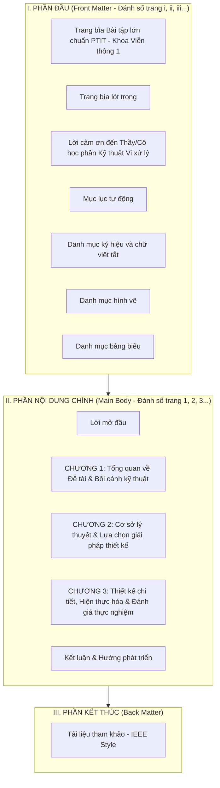

# BỘ QUY TẮC VIẾT QUYỂN BÁO CÁO & CẤU TRÚC ÁP DỤNG CHO DỰ ÁN OTAUTOMOTIVE

> [!NOTE]
> Tài liệu này được tổng hợp và chuẩn hóa dựa trên việc phân tích trực tiếp cấu trúc, quy cách trình bày từ các quyển báo cáo Đề tài Sinh viên NCKH 2025 của **Khoa Kỹ thuật Điện tử 1 – Học viện Công nghệ Bưu chính Viễn thông (PTIT)** (đặc biệt là quyển *Delta OTA trong mạng LoRa*, *Robot Micromouse*, *Hệ thống cân bằng lực đẩy BLDC*, *Dự báo thời tiết*). Quy tắc này được thiết kế may đo để áp dụng trực tiếp cho dự án **Automotive Gateway OTA Dual-Bank Rollback qua CAN Bus**.

---

## PHẦN 1: BỘ QUY TẮC ĐỊNH DẠNG VĂN BẢN (FORMATTING RULES)

### 1. Cấu hình trang in (Page Setup)
* **Khổ giấy:** A4 (210 mm x 297 mm), hướng in dọc (*Portrait*).
* **Căn lề chuẩn (Margins):**
  * Lề trên (*Top*): **2.5 cm** (hoặc 2.0 – 2.5 cm)
  * Lề dưới (*Bottom*): **2.5 cm** (hoặc 2.0 – 2.5 cm)
  * Lề trái (*Left*): **3.0 cm** (dành khoảng trống để đóng gáy/bấm bìa cứng)
  * Lề phải (*Right*): **2.0 cm**
  * Header/Footer: Cách mép giấy **1.5 cm**.

### 2. Phông chữ và Kiểu định dạng (Typography & Styles)
Thống nhất sử dụng duy nhất một bộ phông chữ Unicode: **Times New Roman**.

| Cấp độ cấu trúc | Style Word | Cỡ chữ (*Size*) | Định dạng (*Style*) | Căn lề (*Alignment*) | Khoảng cách đoạn (*Spacing*) | Thụt dòng (*Indent*) |
| :--- | :--- | :---: | :---: | :---: | :---: | :---: |
| **Tiêu đề chương** | `Heading 1` | **16 – 18 pt** | In hoa, Đậm (*Bold*) | Căn giữa hoặc Trái | Before: 12pt, After: 12pt | Không thụt lề |
| **Mục cấp 1** (vd: 1.1, 2.1) | `Heading 2` | **14 – 16 pt** | Đậm (*Bold*) | Căn trái | Before: 6pt, After: 6pt | Không thụt lề |
| **Mục cấp 2** (vd: 1.1.1, 2.1.1) | `Heading 3` | **13 – 14 pt** | Đậm hoặc Đậm nghiêng | Căn trái | Before: 6pt, After: 6pt | Không thụt lề |
| **Mục cấp 3** (vd: 1.1.1.1) | `Heading 4` | **13 pt** | Nghiêng hoặc Đậm | Căn trái | Before: 6pt, After: 6pt | Không thụt lề |
| **Nội dung văn bản** | `Normal` / `Body Text`| **13 pt** | Thường (*Regular*) | Căn đều hai bên (*Justified*) | Before: 0pt, After: 3 – 6pt; Line spacing: **1.3 – 1.5 lines** | First line indent: **1.0 – 1.27 cm** |
| **Tên hình vẽ** | `Caption` | **11 – 12 pt** | Nghiêng hoặc Đậm | Căn giữa (*Center*) | Before: 3pt, After: 6pt | Không thụt lề |
| **Tên bảng biểu** | `Caption` | **11 – 12 pt** | Đậm (*Bold*) | Căn giữa hoặc Trái | Before: 6pt, After: 3pt | Không thụt lề |
| **Ghi chú nguồn / code snippet**| `Code / Note` | **10 – 11 pt** | Thường / Consolas (cho code)| Căn trái | Before: 3pt, After: 3pt | Khung viền mờ |

> [!IMPORTANT]
> **Quy tắc không chia mồ côi (Pagination):**
> * Bật tính năng `Widow/Orphan control` cho toàn bộ văn bản.
> * Với tất cả các Heading (`Heading 1`, `Heading 2`, `Heading 3`), bật tùy chọn `Keep with next` để không bao giờ bị hiện tượng tiêu đề nằm ở cuối trang còn nội dung nằm ở trang sau.
> * Mỗi **Chương mới** luôn bắt đầu từ một trang mới bằng `Page Break` (hoặc `Section Break (Next Page)`).

### 3. Đánh số trang (Page Numbering) & Header/Footer
* **Phần mở đầu (Front Matter):** Bắt đầu từ *Lời cảm ơn* $\rightarrow$ *Mục lục* $\rightarrow$ *Danh mục từ viết tắt* $\rightarrow$ *Danh mục hình vẽ* $\rightarrow$ *Danh mục bảng biểu*: Đánh số trang bằng **chữ số La Mã in thường** (`i`, `ii`, `iii`, `iv`, `v`...). Trang bìa không đánh số.
* **Phần nội dung chính (Main Body):** Bắt đầu từ **LỜI MỞ ĐẦU** / **CHƯƠNG 1** đến hết quyển (*Kết luận*, *Tài liệu tham khảo*, *Phụ lục*): Đánh số bằng **chữ số Ả Rập** (`1`, `2`, `3`...). Bắt đầu lại từ trang `1`.
* **Vị trí số trang:** Đặt ở giữa lề dưới (*Bottom Center*) hoặc góc phải lề dưới (*Bottom Right*).
* **Header:** Có thể để trống hoặc ghi tên báo cáo rút gọn kèm đường kẻ mảnh phân cách.

### 4. Quy tắc Chú thích Hình ảnh, Sơ đồ, Bảng biểu & Công thức
* **Đánh số theo chương:** Mọi hình ảnh và bảng biểu đều phải được gán mã 2 chữ số dạng `[Số_Chương].[Số_Thứ_Tự_Trong_Chương]`.
  * Ví dụ: `Hình 1.1`, `Hình 2.1`, `Hình 2.2`, `Hình 3.1`...; `Bảng 1.1`, `Bảng 3.1`...
* **Hình ảnh (Figures):**
  * Vị trí: Đặt **DƯỚI** hình ảnh.
  * Căn lề: Căn giữa trang.
  * Cú pháp: `Hình [X].[Y]: [Tên mô tả hình ảnh]`
  * Ví dụ: `Hình 2.3: Sơ đồ kiến trúc bộ nhớ Flash Dual-Bank trên STM32F103`.
  * Mọi hình ảnh xuất hiện trong quyển **bắt buộc phải có câu văn trích dẫn đến trước đó** (vd: *"Kiến trúc phân vùng bộ nhớ được mô tả chi tiết như trong Hình 2.3..."*). Không được để hình ảnh xuất hiện mà không có lời dẫn.
* **Bảng biểu (Tables):**
  * Vị trí: Đặt **TRÊN** bảng.
  * Căn lề: Căn giữa hoặc căn trái.
  * Cú pháp: `Bảng [X].[Y]: [Tên mô tả bảng dữ liệu]`
  * Ví dụ: `Bảng 3.2: Kết quả thử nghiệm kịch bản ngắt nguồn và Rollback an toàn`.
* **Công thức toán học (Equations):**
  * Soạn thảo bằng công cụ MathType hoặc Microsoft Equation (Word).
  * Công thức căn giữa dòng, số thứ tự công thức nằm trong ngoặc đơn và căn sát lề phải.
  * Ví dụ: 
    $$CRC16 = \sum_{i=0}^{n} D_i \oplus Poly \quad (2.1)$$

### 5. Quy tắc Trích dẫn và Tài liệu tham khảo (References)
* Sử dụng chuẩn trích dẫn số trong ngoặc vuông **[1], [2], [3]** theo thứ tự xuất hiện đầu tiên trong văn bản (chuẩn IEEE).
* Danh mục tài liệu tham khảo ở cuối quyển phải liệt kê đầy đủ: Tác giả, Năm xuất bản, Tên tài liệu/bài báo, Nơi xuất bản / Nhà xuất bản hoặc Đường dẫn liên kết URL (kèm ngày truy cập).

---

## PHẦN 2: CẤU TRÚC CHUẨN TỔNG THỂ CỦA QUYỂN BÁO CÁO

Một quyển báo cáo kỹ thuật chuẩn Đề tài / Bài tập lớn tại PTIT gồm 3 phần chính với thứ tự bắt buộc:



---

## PHẦN 3: KHUNG MỤC LỤC CHI TIẾT ÁP DỤNG TRỰC TIẾP CHO DỰ ÁN "OTAUTOMOTIVE"

Dưới đây là khung mục lục hoàn chỉnh, được chi tiết hóa theo cấu trúc 3 chương kinh điển của các quyển NCKH PTIT 2025, tích hợp toàn bộ các kết quả thiết kế và hiện thực của dự án **"Thiết kế mô hình Automotive Gateway cho xe điều khiển phân tán: Tích hợp kiến trúc cập nhật phần mềm không dây tự phục hồi (OTA Dual-Bank Rollback) qua mạng CAN Bus"**.

```text
TRANG BÌA CHÍNH (Bìa ngoài mạ vàng/đóng bìa cứng theo mẫu PTIT)
TRANG BÌA PHỤ (Bìa lót trong)
NHẬN XÉT CỦA GIẢNG VIÊN HƯỚNG DẪN
LỜI CẢM ƠN .................................................................... i
MỤC LỤC ....................................................................... ii
DANH MỤC CÁC KÝ HIỆU VÀ CHỮ VIẾT TẮT .......................................... iv
DANH MỤC HÌNH VẼ .............................................................. v
DANH MỤC BẢNG BIỂU ........................................................... vi

LỜI MỞ ĐẦU .................................................................... 1
  1. Bối cảnh và tính cấp thiết của đề tài
  2. Mục tiêu nghiên cứu của đề tài
  3. Đối tượng và phạm vi nghiên cứu
  4. Phương pháp tiếp cận và giải pháp thực hiện
  5. Ý nghĩa khoa học và thực tiễn của đề tài
  6. Bố cục của quyển báo cáo

CHƯƠNG 1: TỔNG QUAN VỀ HỆ THỐNG MẠNG TRUYỀN THÔNG Ô TÔ VÀ CÔNG NGHỆ FOTA ....... 3
  1.1. Tổng quan về kiến trúc điều khiển phân tán trên ô tô hiện đại .............. 3
      1.1.1. Sự phát triển của các khối điều khiển điện tử (ECU) trong xe hơi
      1.1.2. Nhu cầu phân tầng mạng và vai trò trung tâm của Automotive Gateway
      1.1.3. Thách thức trong việc quản trị và bảo trì phần mềm nhúng ô tô
  1.2. Công nghệ cập nhật phần mềm từ xa (FOTA - Firmware Over-The-Air) ............ 6
      1.2.1. Khái niệm và nguyên lý hoạt động tổng quát của FOTA
      1.2.2. Các giai đoạn trong một chu trình cập nhật phần mềm không dây
      1.2.3. Các thách thức kỹ thuật cốt lõi: An toàn dữ liệu, chống bricking và tự phục hồi
  1.3. Tổng quan về mạng truyền thông Controller Area Network (CAN Bus) ............ 9
      1.3.1. Lịch sử hình thành và đặc tính kỹ thuật của giao thức CAN
      1.3.2. Cấu trúc khung truyền CAN 2.0A tiêu chuẩn (11-bit Identifier)
      1.3.3. Cơ chế phân xử tranh chấp bus phi phá hủy (CSMA/CD + NBA)
      1.3.4. Cơ chế kiểm soát lỗi và độ tin cậy trong môi trường xe hơi
  1.4. Tình hình nghiên cứu trong nước và quốc tế ................................. 13
      1.4.1. Các nghiên cứu và giải pháp OTA thương mại trong ngành ô tô (AUTOSAR, OEM)
      1.4.2. Các công trình nghiên cứu sinh viên liên quan đến OTA và IoT nhúng
  1.5. Kết luận chương 1 ......................................................... 15

CHƯƠNG 2: CƠ SỞ LÝ THUYẾT VÀ PHÂN TÍCH LỰA CHỌN GIẢI PHÁP THIẾT KẾ ............... 16
  2.1. Phân tích bài toán và các yêu cầu kỹ thuật của hệ thống .................... 16
      2.1.1. Mô tả bài toán xe điều khiển phân tán 2 cấp (TCU Gateway + Body ECU)
      2.1.2. Yêu cầu vận hành an toàn: Điều kiện tiền đề (Pre-condition Safety Check)
      2.1.3. Yêu cầu toàn vẹn dữ liệu và cơ chế chống ngắt nguồn đột ngột (Power-Cut Recovery)
  2.2. Phân tích và lựa chọn nền tảng phần cứng ................................... 18
      2.2.1. Khối xử lý mạng Telematics (TCU) & Gateway: Vi điều khiển ESP32 DevKitC
      2.2.2. Khối ECU điều khiển thân xe & an toàn: Vi điều khiển STM32F103C8T6 (Blue Pill)
      2.2.3. Khối thu phát CAN Bus vật lý: Module SN65HVD230 (3.3V CAN Transceiver)
      2.2.4. Khối điều khiển công suất động cơ: Mạch cầu H L298P Dual DC Driver
      2.2.5. Khối cơ cấu chấp hành: Động cơ giảm tốc DC bánh xe và Động cơ Servo MG90S (Cần cẩu 2-DOF)
      2.2.6. Khối giám sát và hiển thị: Màn hình OLED SSD1306 (I2C) và Còi cảnh báo Buzzer
      2.2.7. Khối quản lý năng lượng và mạch nguồn hạ áp (LM2596 / AMS1117)
  2.3. Cơ sở lý thuyết về tổ chức bộ nhớ và cơ chế cập nhật tự phục hồi .......... 24
      2.3.1. Kiến trúc bộ nhớ Flash vi điều khiển STM32F103 và cơ chế bảo vệ Page
      2.3.2. Kiến trúc Dual-Bank: Phân vùng Active Partition và Inactive Partition
      2.3.3. Bảng vector ngắt (Vector Table Offset - VTOR) và quy trình Jump ứng dụng an toàn
      2.3.4. Vùng nhớ phi bốc hơi Option Bytes Data0 và cơ chế hoán đổi nguyên tử (Atomic Swap)
  2.4. Thiết kế giao thức truyền nhận dữ liệu OTA qua CAN Bus ..................... 28
      2.4.1. Kiến trúc phân bổ trường bit định danh CAN ID (11-bit Standard ID)
      2.4.2. Bảng định danh thông điệp điều khiển thời gian thực (Control Stream - FIFO 0)
      2.4.3. Bảng quy hoạch và đặc tả khung truyền nạp Firmware (OTA Stream - FIFO 1)
      2.4.4. Giải thuật truyền khối trượt (Burst Chunk) và kiểm tra toàn vẹn đa lớp (CRC16/CRC32)
  2.5. Môi trường phát triển và công cụ hỗ trợ kỹ thuật ........................... 32
      2.5.1. Toolchain biên dịch trần: ARM GNU Toolchain (arm-none-eabi-gcc) & Makefile
      2.5.2. Môi trường phát triển Gateway: VS Code & PlatformIO IDE (ESP-IDF / Arduino core)
      2.5.3. Công cụ nạp và gỡ lỗi phần cứng: ST-Link V2, st-flash, OpenOCD và GDB
      2.5.4. Công cụ thiết kế giao diện: HTML5 Canvas, WebSockets và Responsive CSS
  2.6. Kết luận chương 2 ......................................................... 35

CHƯƠNG 3: THIẾT KẾ CHI TIẾT, HIỆN THỰC HÓA VÀ THỰC NGHIỆM ĐÁNH GIÁ HỆ THỐNG ...... 36
  3.1. Thiết kế kiến trúc tổng thể của hệ thống ................................... 36
      3.1.1. Sơ đồ khối chức năng phần cứng hệ thống (Block Diagram)
      3.1.2. Sơ đồ nguyên lý kết nối chân chi tiết (Wiring & Pinout Schematic)
      3.1.3. Mô hình luồng dữ liệu (Data Flow) giữa Web Client - ESP32 Gateway - STM32 ECU
  3.2. Thiết kế và hiện thực hóa phần mềm trên ESP32 Gateway ...................... 40
      3.2.1. Kiến trúc phần mềm ESP32 (Asynchronous Web Server, TWAI CAN Driver, MicroSD)
      3.2.2. Xây dựng giao diện Web điều khiển công nghiệp (Dual Theme: Dark/Light Mode)
      3.2.3. Module tiếp nhận Firmware OTA 2 nguồn (Direct RAM Buffer Upload & MicroSD Offline)
      3.2.4. Module đóng gói, tính toán CRC và truyền định tuyến dữ liệu CAN
  3.3. Thiết kế và hiện thực hóa phần mềm trên STM32 ECU .......................... 46
      3.3.1. Quy hoạch phân vùng Flash chi tiết (Linker Scripts: Bootloader, App1, App2)
      3.3.2. Thiết kế Bootloader Dual-Bank tự phục hồi (Sơ đồ luồng quyết định khởi động)
      3.3.3. Lớp Low-level Driver (IP): Cấu hình thanh ghi trực tiếp và SPL (bxCAN, Timers, Flash)
      3.3.4. Lớp Dịch vụ Middleware: Quản lý ghi Flash theo Block, bộ đệm phân mảnh và giải mã CRC
      3.3.5. Lớp Ứng dụng:
          - Application 1: Xe điều khiển cơ bản kết hợp cần cẩu 2 bậc tự do (2-DOF Arm)
          - Application 2: Nâng cấp giao diện hiển thị đồ họa OLED HUD và còi cảnh báo đa âm
  3.4. Toàn trình quy trình cập nhật OTA từng bước (Step-by-step OTA Sequence) .... 54
      3.4.1. Giai đoạn 1: Khởi tạo kết nối và kiểm tra điều kiện an toàn dừng xe
      3.4.2. Giai đoạn 2: Bắt tay thương lượng phân vùng đích và xóa Flash khối
      3.4.3. Giai đoạn 3: Truyền phát dữ liệu khối và phản hồi ACK/NACK từng phần
      3.4.4. Giai đoạn 4: Xác thực toàn cục CRC32 và ghi Option Bytes hoán đổi
      3.4.5. Giai đoạn 5: Tự khởi động lại hệ thống và chuyển giao thực thi (Software Reset & Jump)
  3.5. Triển khai kịch bản kiểm thử và kết quả thực nghiệm ........................ 60
      3.5.1. Thiết lập môi trường đo kiểm và công cụ ghi vết (CAN Sniffer / Logic Analyzer)
      3.5.2. Kịch bản TC-01: Truy vấn trạng thái phân vùng đang hoạt động
      3.5.3. Kịch bản TC-02: Toàn trình nạp nâng cấp Firmware thành công (App1 -> App2)
      3.5.4. Kịch bản TC-03: Kiểm thử cơ chế bảo vệ an toàn khi xe đang chuyển động (Pre-condition Reject)
      3.5.5. Kịch bản TC-04: Kiểm thử khả năng chịu lỗi rơi gói tin CAN (Packet Loss & Retry)
      3.5.6. Kịch bản TC-05: Kiểm thử cơ chế phát hiện sai hỏng dữ liệu Chunk (CRC16 Corruption)
      3.5.7. Kịch bản TC-06: Kiểm thử bơm lỗi ngắt nguồn đột ngột trong khi nạp (Power-Cut Fault Injection)
      3.5.8. Kịch bản TC-07: Kiểm thử sai lệch mã định danh ứng dụng / Vector Table không hợp lệ
  3.6. Đánh giá hiệu năng và thảo luận kết quả ................................... 69
      3.6.1. Đánh giá tốc độ truyền tải, thông lượng mạng CAN (Throughput) và thời gian nạp
      3.6.2. Đánh giá độ tin cậy và khả năng chống bricking tuyệt đối của cơ chế Dual-Bank
      3.6.3. Bảng so sánh chỉ tiêu kỹ thuật đạt được so với yêu cầu ban đầu
  3.7. Kết luận chương 3 ......................................................... 72

KẾT LUẬN VÀ HƯỚNG PHÁT TRIỂN ..................................................... 73
  1. Các kết quả chính đã hoàn thành của đề tài
  2. Những đóng góp mới và bài học kinh nghiệm
  3. Các mặt còn hạn chế của mô hình
  4. Hướng mở rộng và phát triển tiếp theo

TÀI LIỆU THAM KHẢO ............................................................... 76
```

---

## PHẦN 4: BẢN ĐỒ ÁNH XẠ TÀI LIỆU DỰ ÁN VÀO TỪNG MỤC TRONG QUYỂN (DATA MAPPING)

Để giúp việc chấp bút viết quyển diễn ra nhanh chóng, toàn bộ các tài liệu hiện có trong thư mục `OTAutomotive/Documents` và mã nguồn được ánh xạ tương ứng vào từng phần của quyển báo cáo như sau:

| Mục trong Quyển Báo cáo | Tài liệu nguồn trong `OTAutomotive/Documents` & Source code | Nội dung chính cần đưa vào |
| :--- | :--- | :--- |
| **Lời mở đầu & 1.1, 2.1** | `ETC/Đề bài.md`, `Project_Management.md` | Bối cảnh bài toán xe phân tán, yêu cầu đề bài của giảng viên, mục tiêu kiến trúc Dual-Bank không dùng HAL. |
| **2.2 (Lựa chọn phần cứng)**| `Wiring_Diagram.md`, `Pinout/*` | Thông số kỹ thuật STM32F103, ESP32, SN65HVD230, L298P, Servo MG90S, OLED SSD1306, sơ đồ chân pinout. |
| **2.3 (Flash & Dual-Bank)** | `Partition.md`, `OptionByte.md` | Bản đồ bộ nhớ 128KB (16KB Boot + 56KB App1 + 56KB App2), cấu hình Option Bytes `0x1FFFF804` (Data0), cơ chế Atomic Swap, VTOR. |
| **2.4 (Giao thức CAN)** | `Wiring_Diagram.md`, `System_Operation_Guide.md` | Bảng CAN ID (`0x600..0x630`, `0x7C0..0x7E0`), cấu trúc frame dữ liệu 8-byte, thuật toán chia mảnh Chunk 512B/1024B, mã CRC16/CRC32. |
| **2.5 (Môi trường & Công cụ)**| `FlashGuide.md`, `System_Operation_Guide.md` | GNU ARM Toolchain, Makefile cấu trúc, PlatformIO, st-flash, OpenOCD, GDB commands. |
| **3.1 (Kiến trúc & Sơ đồ nối)**| `Wiring_Diagram.md` | Bảng kết nối dây toàn diện (Chân ESP32, Chân STM32, Chân CAN Transceiver, Chân L298P, Chân Servo), sơ đồ khối hệ thống. |
| **3.2 (Phần mềm ESP32)** | Mã nguồn `ESP32/App/src/`, `ETC/preview.html` | Xử lý Web Server, WebSockets/POST handler, giao diện Web UI (Dark/Light theme, joystick điều khiển xe, thanh chọn file .bin, tiến trình nạp). |
| **3.3 (Phần mềm STM32)** | `STM32/Bootloader/`, `STM32/App1/`, `STM32/App2/` | Mã nguồn C thuần không dùng HAL: Bootloader (`main.c`, `boot.c`, `flash.c`, `can.c`), Linker scripts (`*.ld`), VTOR shifting, App1 (xe + servo), App2 (HUD OLED + Buzzer). |
| **3.4 (Quy trình nạp OTA)** | `System_Operation_Guide.md` | Các bước tương tác giữa Web Browser $\rightarrow$ ESP32 $\rightarrow$ STM32 Bootloader từ Handshake, Erase, Flash, Verify đến Reboot. |
| **3.5 (Kiểm thử thực nghiệm)**| `Test_Cases_And_Verification.md` | Bảng ma trận 7 kịch bản kiểm thử (TC-01 đến TC-07), phương pháp thực hiện, kết quả đạt được, ảnh chụp màn hình terminal & logic analyzer. |
| **3.6 (Đánh giá hiệu năng)** | `Test_Cases_And_Verification.md`, log thực nghiệm | Bảng đo thời gian truyền, kích thước file, tỉ lệ lỗi, khả năng khôi phục khi bị rút nguồn đột ngột. |
| **Phụ lục** | `FlashGuide.md`, Makefile, Pinout hình ảnh | Toàn văn script nạp, code linker script, lệnh gỡ lỗi nâng cao. |

---

## PHẦN 5: BỘ NGUYÊN TẮC VĂN PHONG VÀ CHECKLIST NGHIỆM THU

### 1. Nguyên tắc văn phong khoa học kỹ thuật
1. **Tính khách quan:** Sử dụng ngôi kể khách quan (sử dụng *"đề tài này nghiên cứu..."*, *"hệ thống được thiết kế theo hướng..."*, *"nhóm thực hiện đã triển khai..."*, tuyệt đối tránh dùng các từ cảm tính như *"tôi thấy rất hay"*, *"phần mềm tuyệt vời"*).
2. **Thuật ngữ chuyên ngành:** 
   * Giữ nguyên các thuật ngữ tiếng Anh chuẩn quốc tế đã phổ biến: *Bootloader*, *Firmware*, *Flash*, *CAN Bus*, *Frame*, *Baudrate*, *Rollback*, *Handshake*, *Breakpoint*, *Option Bytes*, *Linker Script*.
   * Lần đầu tiên xuất hiện thuật ngữ viết tắt trong văn bản phải mở ngoặc giải thích: ví dụ *"Firmware Over-The-Air (FOTA)"*, *"Controller Area Network (CAN)"*.
3. **Mã nguồn (Source code):**
   * Không paste toàn bộ file code dài hàng trăm dòng vào thân bài.
   * Trong các chương chỉ trích dẫn các đoạn code thuật toán cốt lõi (dưới 30 dòng), định dạng bằng phông đơn khoảng (*Monospace/Consolas*), có chú thích rõ ràng. Toàn bộ mã nguồn dài đưa xuống phần **Phụ lục**.

### 2. Danh mục kiểm tra (Checklist) trước khi xuất file và in quyển
- [ ] Khổ giấy chuẩn A4, lề trái đúng 3.0 cm, lề phải 2.0 cm, lề trên 2.5 cm, lề dưới 2.5 cm.
- [ ] Toàn bộ phông chữ là Times New Roman, cỡ 13pt (Normal), giãn dòng 1.3 - 1.5 lines.
- [ ] Phần bìa và lời cảm ơn đến danh mục bảng biểu đánh số La Mã (`i, ii, iii...`).
- [ ] Từ Lời mở đầu / Chương 1 bắt đầu đánh số Ả Rập (`1, 2, 3...`) ở chân trang.
- [ ] Tất cả các tiêu đề chương đều bắt đầu từ một trang mới (`Ctrl + Enter`).
- [ ] Đã cập nhật lại toàn bộ Mục lục tự động (`Update Entire Table`).
- [ ] Đã cập nhật Danh mục hình vẽ và Danh mục bảng biểu tự động.
- [ ] Đã kiểm tra không còn hình ảnh hoặc bảng biểu nào bị thiếu số thứ tự hoặc thiếu lời dẫn trong bài.
- [ ] Kiểm tra các liên kết trích dẫn tài liệu tham khảo [1], [2]... khớp đúng với danh mục ở cuối quyển.
- [ ] Bìa ngoài có khung hoa văn trang trọng theo quy định của Học viện/Khoa.
