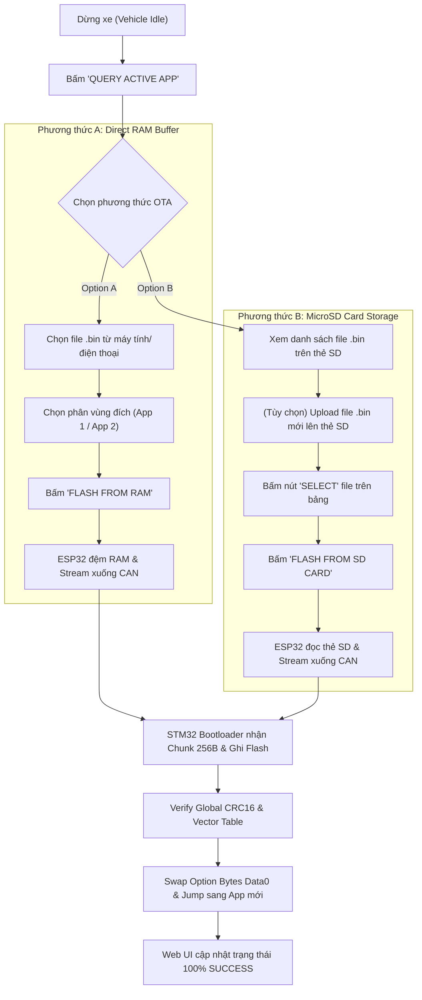

# Hướng Dẫn Triển Khai & Vận Hành Hệ Thống

Tài liệu hướng dẫn quy trình biên dịch, nạp firmware khởi tạo ban đầu, vận hành xe qua giao diện Web công nghiệp (Dark/Light Theme) và cập nhật phần mềm không dây (OTA Dual-Source: Direct RAM Buffer & MicroSD Card) qua mạng CAN Bus 500 kbps.

---

## 1. Môi trường & Biên dịch Firmware

### 1.1. Công cụ yêu cầu
- **ARM GCC Toolchain:** `arm-none-eabi-gcc` (biên dịch STM32)
- **ST-Link Tools:** `st-flash` (nạp trực tiếp qua mạch nạp ST-Link V2)
- **PlatformIO / VS Code:** Biên dịch và nạp cho ESP32 DevKitC

### 1.2. Biên dịch phía STM32 (Makefile)

Mỗi phân vùng có Makefile độc lập:

```bash
# 1. Biên dịch Bootloader (16KB, Origin: 0x08000000)
cd STM32/Bootloader
make clean && make -j4
# Đầu ra: build/bootloader.bin

# 2. Biên dịch Application 1 (56KB, Origin: 0x08004000) - Bản xe cơ bản + Cần cẩu 2-DOF
cd ../App1
make clean && make -j4
# Đầu ra: build/app1.bin

# 3. Biên dịch Application 2 (56KB, Origin: 0x08012000) - Bản nâng cấp Graphic OLED HUD & Còi Horn
cd ../App2
make clean && make -j4
# Đầu ra: build/app2.bin
```

Đầu ra sau khi build thành công tại thư mục `build/` của từng project gồm: `.elf`, `.hex`, `.bin`.  
Tệp nhị phân dùng cho nạp OTA:
- `STM32/App1/build/app1.bin`
- `STM32/App2/build/app2.bin`

### 1.3. Biên dịch phía ESP32 (PlatformIO)

Toàn bộ Gateway được chuẩn hóa vào thư mục `ESP32/App`:

```bash
cd ESP32/App
pio run
```
*Tệp nhị phân xuất ra tại: `.pio/build/esp32dev/firmware.bin`*

---

## 2. Nạp Firmware Khởi tạo Ban đầu (Initial Factory Flash)

Khi xuất xưởng hoặc nạp chip mới, cần nạp trực tiếp qua cổng SWD bằng mạch nạp ST-Link:

```bash
# Nạp Bootloader vào Page 0 (0x08000000)
st-flash write STM32/Bootloader/build/bootloader.bin 0x08000000

# Nạp App 1 vào Page 16 (0x08004000) - Phân vùng chạy mặc định ban đầu
st-flash write STM32/App1/build/app1.bin 0x08004000

# (Tùy chọn) Nạp App 2 vào Page 72 (0x08012000) để sẵn sàng kiểm thử Swap
st-flash write STM32/App2/build/app2.bin 0x08012000
```

Nạp ESP32 Gateway qua cáp USB:
```bash
cd ESP32/App
pio run -t upload
```

---

## 3. Khởi động & Vận hành Xe

### 3.1. Trình tự cấp nguồn phần cứng
1. Kiểm tra jumper 120Ω đã đóng trên cả 2 module SN65HVD230.
2. Kiểm tra chân **PB2 (BOOT1)** trên Blue Pill đang nối xuống **GND (0V)**.
3. Nếu sử dụng thẻ nhớ MicroSD, cắm thẻ đã format FAT32 chứa file `app1.bin` và `app2.bin` vào khe cắm SPI trên ESP32 (CS: GPIO 15).
4. Bật công tắc nguồn pin Li-ion (7.4V - 12V).
5. Quan sát:
   - Module LM2596 sáng LED nguồn (áp ra chuẩn 5.0V).
   - LED trên STM32 sáng báo hiệu phân vùng App đang hoạt động.
   - ESP32 phát Wi-Fi Access Point `AutoCar_Gateway`.

### 3.2. Kết nối & Giao diện Điều khiển (Web Control)
1. Dùng máy tính hoặc điện thoại kết nối vào Wi-Fi:
   - **SSID:** `AutoCar_Gateway`
   - **Mật khẩu:** `12345678` (mặc định trong `config.h`)
2. Mở trình duyệt web, truy cập địa chỉ IP Gateway:
   ```
   http://192.168.4.1
   ```

3. **Tính năng giao diện Web UI:**
   - **Dark / Light Theme:** Bấm nút chuyển giao diện ở góc trên bên phải để đổi nhanh nền Đen tối giản $\leftrightarrow$ Trắng sáng. Cấu hình tự động ghi nhớ vào `localStorage`.
   - **Bàn phím Lái đa hướng (D-Pad):**
     - Tiến: `W` (nút `FWD`, CAN `0x041`)
     - Lùi: `S` (nút `REV`, CAN `0x042`)
     - Xoay Trái: `A` (nút `LEFT`, CAN `0x043`)
     - Xoay Phải: `D` (nút `RIGHT`, CAN `0x044`)
     - Tiến - Lệch Trái (NW): `Q` (nút `NW`, CAN `0x047`)
     - Tiến - Lệch Phải (NE): `E` (nút `NE`, CAN `0x045`)
     - Lùi - Lệch Trái (SW): `Z` (nút `SW`, CAN `0x046`)
     - Lùi - Lệch Phải (SE): `C` (nút `SE`, CAN `0x048`)
     - Dừng khẩn cấp: `Phím cách (Space)` hoặc nút `[E-STOP]` (CAN `0x000`)
   - **Chuyển đổi Chế độ (Mode Switch):**
     - Bấm nút `[MODE]` hoặc phím `M`: Chuyển đổi giữa chế độ **CAR** (Lái bánh xe, CAN `0x001`) và **CRANE** (Cần cẩu, CAN `0x002`).
   - **Điều khiển Cần cẩu (Robotic Arm 2-DOF):**
     - Nâng cần: `ARM UP` (CAN `0x081`) | Hạ cần: `ARM DOWN` (CAN `0x082`)
     - Vươn cần: `ARM EXTEND` (CAN `0x083`) | Thu cần: `ARM RETRACT` (CAN `0x084`)
   - **Còi xe (Horn - Phím H):**
     - Bấm giữ nút `[HORN]` hoặc phím `H`: Phát CAN `0x0C1` bật còi; khi nhả tay: phát CAN `0x0C0` tắt còi.
     - Khi chạy **App 1**: STM32 bỏ qua lệnh còi do không gắn còi phần mềm.
     - Khi chạy **App 2**: Còi Buzzer phát âm thanh tần số 2.5kHz bằng ngắt phần cứng `TIM4` (Non-blocking, xe vẫn lái bình thường khi bấm giữ còi).
   - **Màn hình HUD OLED (App 2):**
     - Hiển thị trực quan theo bố cục 3 vùng với 100% tiếng Anh:
       - **Header:** Tag chế độ `[CAR]` / `[CRANE]`, icon còi sóng âm khi bấm, chấm nhịp tim Heartbeat.
       - **Center:** Bitmap đồ họa 32x32 hiển thị hình ảnh động cơ/cần cẩu + 2 dòng chữ trạng thái tiếng Anh rõ ràng.
       - **Footer:** Telemetry CAN thời gian thực: `APP2 | CAN: 0x... | 500K`.

---

## 4. Quy trình Cập nhật Firmware Không dây (Dual-Source OTA)

Hệ thống hỗ trợ 2 phương thức cập nhật firmware không dây độc lập:



### 4.1. Quy trình A: Nạp trực tiếp qua RAM (Direct RAM Buffer)
Áp dụng khi thao tác nhanh từ điện thoại/laptop mà không cần cắm thẻ nhớ:
1. Đảm bảo xe đang dừng hẳn.
2. Bấm **"QUERY ACTIVE APP"** để lấy trạng thái phân vùng hiện tại (Ví dụ: `Active: App 1`, `Target: App 2`).
3. Chọn phân vùng muốn nạp: `App 1 (0x08004000)` hoặc `App 2 (0x08012000)`.
4. Tại khung **Direct RAM Buffer**, bấm nút chọn tệp và duyệt file `app2.bin` trên máy tính.
5. Bấm **"FLASH FROM RAM"**.
6. Trình duyệt truyền luồng file lên RAM của ESP32. ESP32 tự động bắt tay với Bootloader STM32 qua CAN (`0x600 [0xDEADBEEF]`), xóa phân vùng đích, truyền từng Chunk 256 bytes kèm CRC và hoán đổi Option Bytes an toàn.

### 4.2. Quy trình B: Nạp thông qua Thẻ nhớ MicroSD (MicroSD Storage)
Áp dụng cho môi trường thực tế xe ô tô khi firmware được chuẩn bị sẵn hoặc lưu trữ nhiều phiên bản dự phòng trên thẻ:
1. Cắm thẻ nhớ MicroSD chứa các file `.bin` (như `app1.bin`, `app2.bin`) vào module thẻ nhớ ESP32.
2. Tại bảng **MicroSD Card**, danh sách file sẽ hiển thị tên và dung lượng từng file `.bin`.
3. Bấm nút **"SELECT"** tại hàng chứa file muốn nạp trên bảng danh sách.
4. Chọn phân vùng đích tương ứng (`App 1` hoặc `App 2`).
5. Bấm **"FLASH FROM SD CARD"**. ESP32 sẽ mở luồng đọc từng khối từ thẻ SD và truyền trực tiếp xuống Bootloader qua CAN Bus.

---

## 5. Kịch Bản Trình Diễn Demo Tính Năng (App 1 vs App 2 Feature Differentiation)

Kịch bản trực quan chứng minh xe cập nhật phần mềm không dây thành công và mở rộng tính năng mới:

| Giai đoạn | Phiên bản chạy | Tính năng trên Xe & Web UI | Phản ứng hệ thống |
| :--- | :---: | :--- | :--- |
| **Giai đoạn 1** | **App 1 (Base Demo)** | - Xe chạy tiến, lùi, rẽ, điều khiển cần cẩu 2-DOF.<br>- Bấm còi trên Web: Không có tiếng còi (App 1 tinh gọn không trang bị còi).<br>- Màn hình OLED tắt (tiết kiệm bộ nhớ). | Phân vùng hoạt động: `App 1` (`0x08004000`). Option Bytes `Data0 = 0x01`. |
| **Giai đoạn 2** | **Thực hiện OTA** | - Xe tự động dừng động cơ an toàn.<br>- STM32 hiển thị màn hình OLED `OTA FLASHING...` (nếu đang ở App2) và chuyển sang Bootloader.<br>- Thanh tiến trình OTA nhảy từ `0%` $\rightarrow$ `100%` với thông số Chunk chi tiết. | Bootloader xóa phân vùng đích, nạp `app2.bin`, kiểm tra Global CRC16 Modbus. |
| **Giai đoạn 3** | **App 2 (Pro Demo)** | - Xe tự động khởi động vào App 2.<br>- Màn hình OLED SSD1306 bật sáng hiển thị Dashboard 3 vùng đồ họa 32x32 và 100% tiếng Anh.<br>- Bấm giữ nút `[HORN]` (phím `H`): Còi xe kêu to rõ ràng 2.5kHz, icon loa trên OLED hiển thị sóng âm; nhả tay còi tắt ngay.<br>- Xe vẫn lái mượt mà khi bấm giữ còi. | Phân vùng hoạt động: `App 2` (`0x08012000`). Option Bytes `Data0 = 0x02`. |
| **Giai đoạn 4** | **Rollback (Thử lỗi)** | - Tích chọn checkbox `Inject CRC Error (Test Rollback)`.<br>- Bấm Flash file lỗi.<br>- STM32 phát hiện sai lệch Global CRC16, từ chối nạp, xóa sạch vùng lỗi và tự động Rollback về bản cũ. | Xe tiếp tục hoạt động an toàn trên bản firmware cũ, không bị brick. |

---

## 6. Quy trình Cứu hộ Khẩn cấp (Emergency Recovery)

Áp dụng khi cả hai bản firmware đều gặp lỗi hoặc hệ thống mất nguồn đột ngột khi đang ghi Flash:

### Trường hợp 1: Tự phục hồi tự động (Atomic Option Bytes Rollback)
- Nhờ cơ chế **Atomic Swap**, thanh ghi Option Bytes chỉ được ghi duy nhất 1 lần ở bước kết thúc sau khi toàn bộ Flash đã vượt qua kiểm tra Global CRC16 và con trỏ Vector Table (MSP $\in$ SRAM, Reset_Handler $\in$ Phân vùng Flash).
- Nếu mất nguồn hoặc đứt cáp CAN giữa chừng: Khi cấp nguồn lại, Bootloader đọc Option Bytes vẫn trỏ về phiên bản App trước đó và tự động boot bình thường.

### Trường hợp 2: Cứu hộ bằng Jumper phần cứng (Hardware Lab Mode)
Áp dụng trong phòng thí nghiệm khi cả 2 phân vùng App đều bị hỏng do nạp file sai:
1. Tắt nguồn xe.
2. Rút jumper **PB2 (BOOT1)** trên board Blue Pill và cắm sang mức **3.3V (HIGH)**.
3. Bật nguồn xe $\rightarrow$ STM32 bị ép dừng lại ở Bootloader vĩnh viễn, phát thông báo sẵn sàng nhận lệnh CAN.
4. Trên giao diện Web ESP32 thực hiện nạp lại bản firmware chuẩn (`app1.bin` hoặc `app2.bin`).
5. Sau khi nạp thành công, cắm lại jumper **PB2 về mức GND (LOW)** để xe hoạt động bình thường.
