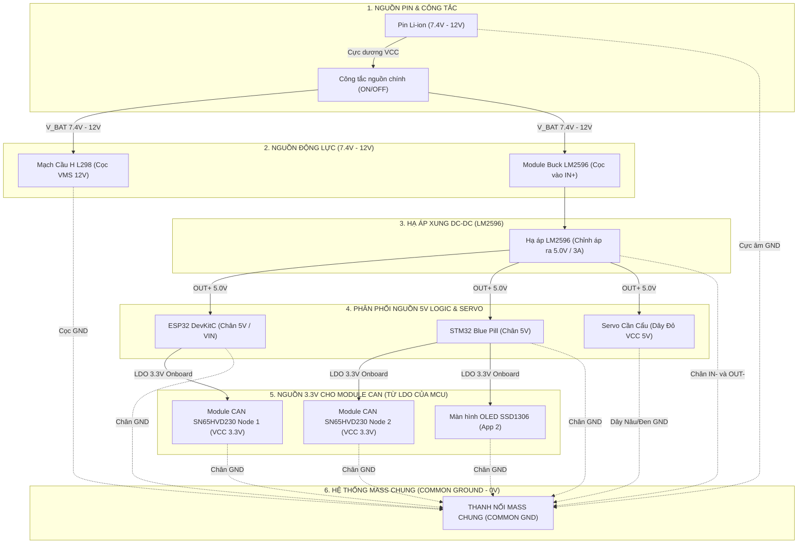

# SƠ ĐỒ NỐI DÂY TOÀN HỆ THỐNG (HARDWARE WIRING DIAGRAM)
**Dự án:** Automotive Gateway cho xe điều khiển phân tán - Tích hợp OTA Dual-Bank Rollback qua CAN Bus  
**Phiên bản tài liệu:** 2.0 (Cập nhật chuẩn hóa thực tế xe)  
**Ngày cập nhật:** 09/11/2026  

---

## 1. TỔNG QUAN HỆ THỐNG PHẦN CỨNG

Hệ thống được thiết kế theo kiến trúc điều khiển phân tán ô tô (Automotive Distributed Architecture) gồm 2 ECU chính:
1. **TCU / Gateway (ESP32 DevKitC):** Đóng vai trò Telematics Control Unit, phát Wi-Fi AP / Web Server để nhận lệnh điều khiển lái xe, tiếp nhận file Firmware (`.bin`), quản lý lưu trữ MicroSD và băm nhỏ đóng gói dữ liệu định tuyến xuống mạng CAN Bus.
2. **ECU Điều Khiển & An Toàn (STM32F103C8T6 Blue Pill):** Đóng vai trò Body/Powertrain ECU:
   - Nhận lệnh điều khiển động cơ qua mạng CAN Bus (500 kbps).
   - Điều khiển cụm cầu H L298P cho 4 bánh xe và 2 động cơ Servo MG90S cho cần cẩu 2-DOF (Nâng/Hạ và Vươn/Thu).
   - Điều khiển còi Buzzer thụ động 2.5kHz (App2) và màn hình hiển thị OLED SSD1306 (App2).
   - Thực thi Bootloader Dual-Bank tự phục hồi (Atomic Swap qua Option Bytes Data0) khi cập nhật Firmware.
3. **Mạng truyền thông CAN Bus (SN65HVD230 x 2):** Kết nối ESP32 và STM32 ở tốc độ cao (500 kbps), phân luồng ID 11-bit chuẩn ô tô.
4. **Hệ thống chấp hành (Actuators):** Module điều khiển động cơ DC L298 (2 cụm bánh xe trái/phải) và 02 Động cơ Servo điều khiển cần cẩu 2-DOF.
5. **Khối nguồn (Power Management):** Pin Li-ion (7.4V - 12V) kết hợp Module hạ áp xung Buck LM2596 (5V-3A) cấp nguồn logic ổn định cho vi điều khiển và cảm biến/servo.

---

## 2. SƠ ĐỒ KHỐI PHẦN CỨNG (SYSTEM BLOCK DIAGRAM)

```mermaid
flowchart TD
    subgraph POWER["KHỐI NGUỒN (POWER SUPPLY)"]
        BAT["Pin Li-ion (7.4V - 12V)"] -->|VCC Pin| SWITCH["Công tắc nguồn ON/OFF"]
        SWITCH -->|Nguồn động lực 7.4V - 12V| L298N_PWR["L298 Power IN (12V)"]
        SWITCH -->|VIN 7.4V - 12V| LM2596["Module Buck LM2596 (Hạ áp 5V/3A)"]
        LM2596 -->|5V Logic| ESP_5V["ESP32 5V Pin"]
        LM2596 -->|5V Logic| STM_5V["STM32 Blue Pill 5V Pin"]
        LM2596 -->|5V Servo| SERVO_PWR["Servo VCC (5V)"]
        GND_SYS["MASS CHUNG (COMMON GND)"] --- BAT
        GND_SYS --- LM2596
        GND_SYS --- ESP_5V
        GND_SYS --- STM_5V
        GND_SYS --- L298N_PWR
        GND_SYS --- SERVO_PWR
    end

    subgraph TCU_GATEWAY["TCU / GATEWAY NODE (ESP32)"]
        ESP["ESP32 DevKitC"]
        CAN_TRANS_ESP["Module CAN Transceiver (SN65HVD230 Node 1)"]
        ESP -->|GPIO 5 / CAN_TX| CAN_TRANS_ESP
        CAN_TRANS_ESP -->|GPIO 4 / CAN_RX| ESP
        ESP -.->|3.3V va GND| CAN_TRANS_ESP
        
        SD_CARD["Module Thẻ Nhớ MicroSD (SPI)"]
        ESP -->|GPIO 15 / CS| SD_CARD
        ESP -->|GPIO 18 / SCK| SD_CARD
        ESP -->|GPIO 19 / MISO| SD_CARD
        ESP -->|GPIO 23 / MOSI| SD_CARD

        ESP -->|Wi-Fi 2.4GHz| USER["Điện thoại / Laptop (Web Control & OTA UI)"]
    end

    subgraph CAN_NETWORK["MẠNG TRUYỀN THÔNG CAN BUS (500 kbps)"]
        CAN_TRANS_ESP ---|CANH Day xoan doi| CANH_LINE["CAN_HIGH Bus Line"]
        CAN_TRANS_ESP ---|CANL Day xoan doi| CANL_LINE["CAN_LOW Bus Line"]
        CANH_LINE --- CAN_TRANS_STM["Module CAN Transceiver (SN65HVD230 Node 2)"]
        CANL_LINE --- CAN_TRANS_STM
        TERM1["Trở đầu cuối 120 Ohm On-module"] -.- CAN_TRANS_ESP
        TERM2["Trở đầu cuối 120 Ohm On-module"] -.- CAN_TRANS_STM
    end

    subgraph ECU_CONTROL["ECU ĐIỀU KHIỂN & AN TOÀN (STM32)"]
        STM["STM32F103C8T6 (Blue Pill)"]
        CAN_TRANS_STM -->|PA11 / CAN_RX| STM
        STM -->|PA12 / CAN_TX| CAN_TRANS_STM
        STM -.->|3.3V va GND| CAN_TRANS_STM
        
        UART_DEBUG["USB-TTL / ST-Link Debug"]
        STM -->|PA9 / USART1_TX| UART_DEBUG
        UART_DEBUG -->|PA10 / USART1_RX| STM
        
        PB2_JUMP["Jumper PB2 (BOOT1 Cứu hộ)"] -->|PB2| STM
        LED_PC13["PC13 (Status LED)"] --- STM
    end

    subgraph ACTUATORS["CƠ CẤU CHẤP HÀNH (ACTUATORS & MOTORS)"]
        L298["Mạch Cầu H L298"]
        STM -->|PB12 - IN1| L298
        STM -->|PB13 - IN2| L298
        STM -->|PB14 - IN3| L298
        STM -->|PB15 - IN4| L298
        
        MOTOR_R["Cụm Bánh Phải"]
        MOTOR_L["Cụm Bánh Trái"]
        L298 -->|OUT1, OUT2| MOTOR_R
        L298 -->|OUT3, OUT4| MOTOR_L
        
        SERVO_LIFT["Servo Nâng Cần (TIM3_CH1)"]
        SERVO_EXT["Servo Vươn Cần (TIM3_CH2)"]
        STM -->|PA6 - PWM 50Hz| SERVO_LIFT
        STM -->|PA7 - PWM 50Hz| SERVO_EXT
    end

    subgraph EXT_APP2["NGOẠI VI NÂNG CAO (DEMO APP 2)"]
        BUZZER["Còi Buzzer Thụ Động 2.5kHz"]
        OLED["Màn hình OLED SSD1306 (128x64)"]
        STM -->|PA0 - TIM4 ISR 2.5kHz| BUZZER
        STM -->|PB6 - SCL| OLED
        STM -->|PB7 - SDA| OLED
    end
```

---

## 3. BẢNG ĐẤU NỐI CHI TIẾT THEO TỪNG MODULE (PINOUT MAPPING)

### 3.1. Mạch Thu Phát CAN 1 (SN65HVD230 nối với ESP32)
*Cấu hình trong code: `ESP32/App/src/config.h`*

| Chân Module SN65HVD230 | Chân ESP32 DevKitC | Loại tín hiệu | Chức năng / Ghi chú |
| :--- | :--- | :--- | :--- |
| **3V3 (VCC)** | **3V3** | Nguồn | Module SN65HVD230 chạy chuẩn logic 3.3V |
| **GND** | **GND** | Nguồn Mass | Nối Mass chung hệ thống |
| **CTX (D)** | **GPIO 5** | Output (ESP32) | TWAI/CAN Transmit (`CAN_TX_PIN`) |
| **CRX (R)** | **GPIO 4** | Input (ESP32) | TWAI/CAN Receive (`CAN_RX_PIN`) |
| **CANH** | Bus CANH | Đường truyền vi sai | Nối sang CANH của Module CAN 2 |
| **CANL** | Bus CANL | Đường truyền vi sai | Nối sang CANL của Module CAN 2 |
| **Jumper 120Ω (R)** | *Đóng Jumper (Cắm)* | Trở đầu cuối | Kích hoạt điện trở 120Ω ở đầu Bus phía ESP32 |

---

### 3.2. Mạch Thu Phát CAN 2 (SN65HVD230 nối với STM32F103C8T6)
*Cấu hình trong code: `STM32/Bootloader/Src/can.c` và `STM32/App1/Src/can_driver.c`, `STM32/App2/Src/can_driver.c`*

| Chân Module SN65HVD230 | Chân STM32 Blue Pill | Loại tín hiệu | Chức năng / Ghi chú |
| :--- | :--- | :--- | :--- |
| **3V3 (VCC)** | **3.3V** | Nguồn | Cấp từ nguồn 3.3V LDO của STM32 |
| **GND** | **GND** | Nguồn Mass | Nối Mass chung hệ thống |
| **CTX (D)** | **PA12** | Output (STM32) | CAN1_TX (Alternate Function Push-Pull) |
| **CRX (R)** | **PA11** | Input (STM32) | CAN1_RX (Input Pull-Up) |
| **CANH** | Bus CANH | Đường truyền vi sai | Nối sang CANH của Module CAN 1 |
| **CANL** | Bus CANL | Đường truyền vi sai | Nối sang CANL của Module CAN 1 |
| **Jumper 120Ω (R)** | *Đóng Jumper (Cắm)* | Trở đầu cuối | Kích hoạt điện trở 120Ω ở cuối Bus phía STM32 |

> [!NOTE]
> Hai dây CANH và CANL nên được **xoắn đôi (twisted-pair)** với nhau để triệt tiêu nhiễu điện từ do động cơ DC gây ra.

---

### 3.3. STM32F103C8T6 với Mạch Cầu H L298 (Điều Khiển Động Cơ)
*Cấu hình trong code: `motor.h` & `motor.c`*

| Chân Module L298 | Chân STM32 Blue Pill | Chức năng | Ý nghĩa điều khiển |
| :--- | :--- | :--- | :--- |
| **IN1** | **PB12** | GPIO Output | Cụm bánh phải — Tiến (Right Forward) |
| **IN2** | **PB13** | GPIO Output | Cụm bánh phải — Lùi (Right Reverse) |
| **IN3** | **PB14** | GPIO Output | Cụm bánh trái — Tiến (Left Forward) |
| **IN4** | **PB15** | GPIO Output | Cụm bánh trái — Lùi (Left Reverse) |
| **ENA, ENB** | *Cắm sẵn Jumper 5V* | Enable Cầu H | Cầu H luôn mở để nhận trực tiếp tín hiệu logic từ PB12-PB15 |
| **OUT1, OUT2** | Cọc Motor Phải | Công suất | Cấp điện cho Động cơ Phải |
| **OUT3, OUT4** | Cọc Motor Trái | Công suất | Cấp điện cho Động cơ Trái |
| **12V (Power IN)**| Pin (+) sau công tắc | Nguồn động lực | Nguồn pin trực tiếp (7.4V - 12V) |
| **GND** | Mass chung | Nguồn Mass | Nối chung với Mass STM32, ESP32, LM2596 |
| **5V (Logic IN)** | 5V từ LM2596 | Nguồn logic | Nguồn cấp IC L298 |

#### Bảng trạng thái Logic điều khiển xe:
| Lệnh điều khiển | CAN ID | IN1 (PB12) | IN2 (PB13) | IN3 (PB14) | IN4 (PB15) | Mô tả chuyển động |
| :--- | :---: | :---: | :---: | :---: | :---: | :--- |
| **Dừng (STOP)** | `0x040` | LOW | LOW | LOW | LOW | Dừng hoàn toàn 2 cụm bánh |
| **Tiến (FORWARD)** | `0x041` | HIGH | LOW | HIGH | LOW | Cả hai cụm bánh cùng tiến |
| **Lùi (BACKWARD)** | `0x042` | LOW | HIGH | LOW | HIGH | Cả hai cụm bánh cùng lùi |
| **Xoay Trái (TURN LEFT)** | `0x043` | HIGH | LOW | LOW | HIGH | Phải tiến, Trái lùi $\rightarrow$ Xoay tại chỗ trái |
| **Xoay Phải (TURN RIGHT)**| `0x044` | LOW | HIGH | HIGH | LOW | Trái tiến, Phải lùi $\rightarrow$ Xoay tại chỗ phải |
| **Tiến lệch phải (NE)** | `0x045` | LOW | LOW | HIGH | LOW | Chỉ cụm trái tiến $\rightarrow$ Xe tiến lệch phải |
| **Lùi lệch trái (SW)** | `0x046` | LOW | LOW | LOW | HIGH | Chỉ cụm trái lùi $\rightarrow$ Xe lùi lệch trái |
| **Tiến lệch trái (NW)** | `0x047` | HIGH | LOW | LOW | LOW | Chỉ cụm phải tiến $\rightarrow$ Xe tiến lệch trái |
| **Lùi lệch phải (SE)** | `0x048` | LOW | HIGH | LOW | LOW | Chỉ cụm phải lùi $\rightarrow$ Xe lùi lệch phải |

---

### 3.4. STM32F103C8T6 với Động Cơ Servo (Cần Cẩu 2-DOF)
*Cấu hình trong code: `servo.h` & `servo.c` qua Timer 3 PWM 50Hz (chu kỳ 20ms = 20000us)*

| Chân Servo | Điểm kết nối STM32 | Chức năng / Thông số kỹ thuật |
| :--- | :--- | :--- |
| **Servo Nâng (Trái)** | **PA6** *(TIM3_CH1)* | Điều khiển góc nâng cần cẩu ($0^\circ \dots 70^\circ$). CAN ID `0x081` (Lên) / `0x082` (Xuống) |
| **Servo Duỗi (Phải)** | **PA7** *(TIM3_CH2)* | Điều khiển góc vươn/thu cần cẩu ($0^\circ \dots 70^\circ$). CAN ID `0x083` (Vươn) / `0x084` (Thu) |
| **VCC (Dây Đỏ)** | **OUT+ (5V) LM2596** | Nguồn 5V dòng cao (>1.5A). **TUYỆT ĐỐI KHÔNG** cấp từ chân 3.3V của STM32 |
| **GND (Dây Nâu/Đen)** | **GND chung** | Nối vào hệ thống Mass chung |

---

### 3.5. Cổng Debug UART & Chân Cứu Hộ Bootloader trên STM32
*Cấu hình trong code: `STM32/Bootloader/Src/bootloader.c`*

| Chân STM32 | Kết nối ngoại vi | Vai trò / Mô tả chi tiết |
| :--- | :--- | :--- |
| **PA9** | RX của mạch USB-TTL / ST-Link | USART1_TX (115200 bps) - Xuất Log Bootloader & Trace OTA |
| **PA10** | TX của mạch USB-TTL / ST-Link | USART1_RX (115200 bps) - Nhận lệnh debug qua Serial Terminal |
| **PB2** | Jumper BOOT1 / Nút gạt | **Jumper cứu hộ bàn Lab (Recovery Mode):** - Nối xuống GND: Chạy bình thường (đọc Option Byte Data0 để boot). - Nối lên 3.3V (HIGH): Ép Bootloader dừng lại chờ nạp OTA qua CAN. |
| **PC13** | Onboard LED | LED báo trạng thái MCU (Active LOW). Nhấp nháy theo tần số phân biệt Bootloader / App1 / App2. |
| **PA13** | SWDIO của ST-Link V2 | Nạp firmware và debug mạch phần cứng qua giao diện SWD |
| **PA14** | SWCLK của ST-Link V2 | Xung clock nạp SWD |

---

### 3.6. Mạch Đọc Thẻ Nhớ SD Card cho ESP32 *(Lưu trữ & nạp firmware độc lập)*
*Cấu hình trong code: `ESP32/App/src/config.h` và `SD_Manager.cpp`*

| Chân Module SD | Chân ESP32 | Giao diện SPI chuẩn | Chức năng |
| :--- | :--- | :--- | :--- |
| **CS** | **GPIO 15** | `SD_CS_PIN` | Chip Select chân chọn thẻ |
| **MOSI** | **GPIO 23** | VSPI_MOSI | Master Out Slave In |
| **MISO** | **GPIO 19** | VSPI_MISO | Master In Slave Out |
| **SCK / CLK** | **GPIO 18** | VSPI_SCK | Xung nhịp đồng bộ SPI |
| **VCC** | **5V hoặc 3.3V** | Nguồn cấp module | Nối nguồn 5V (nếu module có LDO) hoặc 3.3V |
| **GND** | **GND** | Mass chung | Nối Mass chung hệ thống |

---

### 3.7. Ngoại Vi Mở Rộng Demo Tính Năng trên STM32 (App 2 Feature Differentiation)
*Được triển khai độc quyền trong `STM32/App2`: App 1 chỉ chạy động cơ + servo; App 2 mở khóa còi và màn hình đồ họa HUD.*

| Ngoại vi | Chân STM32 | Chuẩn giao tiếp | Vai trò / Mô tả hoạt động |
| :--- | :--- | :--- | :--- |
| **Còi Buzzer (Horn)** | **PA0** | TIM4 ISR (2.5kHz) | Còi thụ động 5V. Ngắt phần cứng `TIM4` 5kHz tạo xung vuông 2.5kHz (Non-blocking). Nhận CAN `0x0C1` (Bật) / `0x0C0` (Tắt). |
| **Màn hình OLED SSD1306** | **PB6** | I2C SCL | Software I2C SCL kết nối màn hình OLED 128x64 (địa chỉ `0x78`) |
| **Màn hình OLED SSD1306** | **PB7** | I2C SDA | Software I2C SDA truyền dữ liệu bitmap đồ họa 32x32 và text tiếng Anh |
| **Nguồn OLED** | **3.3V & GND** | Nguồn Logic | Cấp từ nguồn 3.3V và Mass chung STM32 |

---

## 4. SƠ ĐỒ PHÂN PHỐI NGUỒN VÀ TIẾP ĐỊA (POWER DISTRIBUTION & GROUNDING)

### Bảng phân phối điện áp chi tiết:

| Đường nguồn | Mức điện áp | Nguồn cấp | Thiết bị tiêu thụ | Dòng tải ước tính | Lưu ý an toàn |
| :--- | :---: | :--- | :--- | :---: | :--- |
| **V_BAT (Động lực)** | 7.4V - 12V | Pin Li-ion | Cọc 12V L298 (2 cụm động cơ DC), Ngõ vào LM2596 | 1.5A - 3.0A | Đi dây điện tiết diện $\ge 0.5\text{mm}^2$, qua công tắc $\ge 3\text{A}$ |
| **VCC 5V (Logic & Servo)**| 5.0V | Ngõ ra OUT+ LM2596 | Chân 5V ESP32, Chân 5V STM32, VCC Đỏ Servo cần cẩu | 0.8A - 1.5A | Điều chỉnh biến trở LM2596 đúng 5.0V trước khi cắm vào MCU và Servo |
| **VCC 3.3V (Transceiver & OLED)**| 3.3V | LDO Onboard ESP32 / STM32 | Module CAN SN65HVD230 #1 & #2, OLED SSD1306 | ~80mA - 150mA | Tuyệt đối không cắm Module CAN SN65HVD230 vào nguồn 5V |
| **GND (Mass chung)** | 0V | Cực âm Pin | Toàn bộ chân GND của tất cả các mạch | - | **BẮT BUỘC nối chung Mass** để các mức tín hiệu CAN và PWM đồng mức tham chiếu |

---

## 5. BẢNG TỔNG HỢP TOÀN BỘ CHÂN KẾT NỐI (PIN ASSIGNMENT MASTER TABLE)

| Vi điều khiển | Tên Chân (Pin) | Module kết nối | Chân ngoại vi | Chức năng chi tiết |
| :--- | :--- | :--- | :--- | :--- |
| **ESP32** | **GPIO 4** | SN65HVD230 #1 | CRX / R | Nhận dữ liệu CAN từ STM32 |
| **ESP32** | **GPIO 5** | SN65HVD230 #1 | CTX / D | Phát dữ liệu CAN sang STM32 |
| **ESP32** | **GPIO 15** | MicroSD Adapter | CS | Chọn chip thẻ nhớ SPI (`SD_CS_PIN`) |
| **ESP32** | **GPIO 18** | MicroSD Adapter | SCK | Xung nhịp SPI thẻ nhớ |
| **ESP32** | **GPIO 19** | MicroSD Adapter | MISO | Đọc dữ liệu thẻ nhớ |
| **ESP32** | **GPIO 23** | MicroSD Adapter | MOSI | Ghi dữ liệu thẻ nhớ |
| **ESP32** | **5V (VIN)** | LM2596 Module | OUT+ (5V) | Cấp nguồn nuôi bo ESP32 |
| **ESP32** | **GND** | Common GND | Bus GND | Mass chung hệ thống |
| **STM32F103** | **PA11** | SN65HVD230 #2 | CRX / R | CAN1_RX (Định tuyến FIFO0/FIFO1) |
| **STM32F103** | **PA12** | SN65HVD230 #2 | CTX / D | CAN1_TX (Phát gói tin OTA/Status) |
| **STM32F103** | **PA9** | USB-TTL Debugger | RX | USART1_TX (In Log 115200 bps) |
| **STM32F103** | **PA10** | USB-TTL Debugger | TX | USART1_RX (Nhận lệnh Serial) |
| **STM32F103** | **PB12** | Mạch L298 | IN1 | Cụm bánh phải — Tiến |
| **STM32F103** | **PB13** | Mạch L298 | IN2 | Cụm bánh phải — Lùi |
| **STM32F103** | **PB14** | Mạch L298 | IN3 | Cụm bánh trái — Tiến |
| **STM32F103** | **PB15** | Mạch L298 | IN4 | Cụm bánh trái — Lùi |
| **STM32F103** | **PA6** | Servo Nâng | Signal (Cam/Vàng) | TIM3_CH1: PWM 50Hz nâng cần cẩu ($0^\circ \dots 70^\circ$) |
| **STM32F103** | **PA7** | Servo Duỗi | Signal (Cam/Vàng) | TIM3_CH2: PWM 50Hz duỗi cần cẩu ($0^\circ \dots 70^\circ$) |
| **STM32F103** | **PA0** | Còi Buzzer | Signal (VCC) | TIM4 ISR: Xung vuông 2.5kHz điều khiển Còi (App 2) |
| **STM32F103** | **PB6** | OLED SSD1306 | SCL | Software I2C SCL: Màn hình Dashboard App 2 |
| **STM32F103** | **PB7** | OLED SSD1306 | SDA | Software I2C SDA: Màn hình Dashboard App 2 |
| **STM32F103** | **PB2** | Jumper / Switch | BOOT1 | Gạt 3.3V: Cứu hộ Bootloader khẩn cấp |
| **STM32F103** | **PC13** | Onboard LED | - | Báo trạng thái nạp Flash / Đang chạy App |
| **STM32F103** | **5V** | LM2596 Module | OUT+ (5V) | Cấp nguồn nuôi bo Blue Pill |
| **STM32F103** | **GND** | Common GND | Bus GND | Mass chung hệ thống |

---

## 6. CÁC QUY TẮC AN TOÀN & BẢO VỆ PHẦN CỨNG (CRITICAL HARDWARE RULES)

> [!CAUTION]
> **1. Quy tắc Mass chung (Common Ground):**  
> Toàn bộ các cực âm (GND) của Pin, LM2596, L298, STM32, ESP32 và 2 Module CAN **bắt buộc phải được kết nối chung với nhau**. Nếu không chung Mass, tín hiệu vi sai CAN Bus sẽ bị sai lệch điện áp ngưỡng, dẫn đến mất gói tin hoặc cháy ngõ vào GPIO.

> [!WARNING]
> **2. Mức điện áp cấp cho Module CAN SN65HVD230:**  
> Module SN65HVD230 là dòng CAN Transceiver chạy nguồn **3.3V**. Chỉ cấp chân VCC của module vào ngõ ra **3.3V** của ESP32 và STM32. Không cắm vào ngõ ra 5V vì sẽ gây hư hỏng transceiver và các chân GPIO PA11/PA12, GPIO4/GPIO5.

> [!IMPORTANT]
> **3. Nguồn nuôi Động cơ Servo:**  
> Động cơ Servo (SG90 / MG90S) khi quay có dòng tức thời lên đến 0.8A - 1.5A.  
> - **KHÔNG ĐƯỢC** lấy nguồn 3.3V hoặc 5V từ chân bo mạch STM32/ESP32 để nuôi Servo (gây sụt áp làm MCU reset liên tục).  
> - **PHẢI** cấp nguồn trực tiếp từ ngõ ra 5V của module nguồn Buck LM2596.

> [!TIP]
> **4. Chống nhiễu Motor lên đường truyền CAN:**  
> - Hàn thêm các tụ gốm 104 (100nF) vào 2 cực của mỗi động cơ DC để triệt tiêu tia lửa điện từ chổi than.  
> - Tuyến dây CANH - CANL cần bện xoắn đôi (twisted-pair), chạy cách xa dây nguồn công suất 12V của động cơ DC.  
> - Kiểm tra chắc chắn đã đóng Jumper trở đầu cuối 120Ω trên cả 2 module SN65HVD230 (đo điện trở giữa chân CANH và CANL khi ngắt nguồn toàn mạch phải xấp xỉ ~60Ω).
