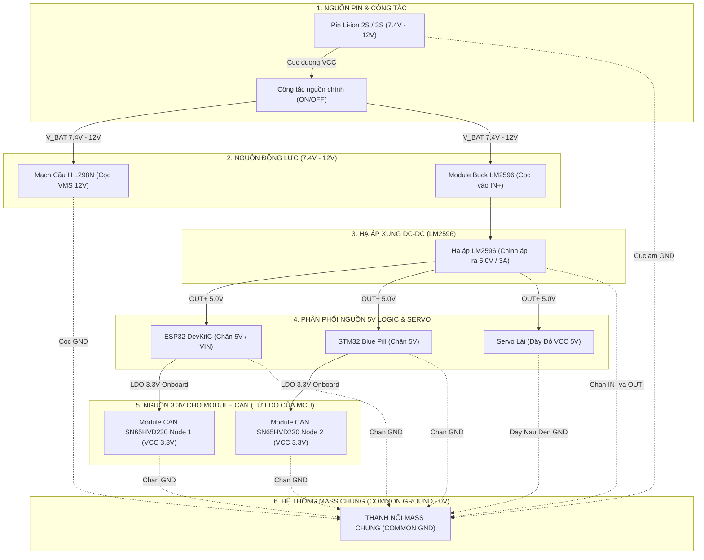

# SƠ ĐỒ NỐI DÂY TOÀN HỆ THỐNG (HARDWARE WIRING DIAGRAM)
**Dự án:** Automotive Gateway cho xe điều khiển phân tán - Tích hợp OTA Dual-Bank Rollback qua CAN Bus  
**Phiên bản tài liệu:** 1.0  
**Ngày lập:** 14/10/2026  

---

## 1. TỔNG QUAN HỆ THỐNG PHẦN CỨNG

Hệ thống được thiết kế theo kiến trúc điều khiển phân tán ô tô (Automotive Distributed Architecture) gồm 2 ECU chính:
1. **TCU / Gateway (ESP32 DevKitC):** Đóng vai trò Telematics Control Unit, phát Wi-Fi AP / Web Server để nhận lệnh điều khiển lái xe và tiếp nhận file Firmware (`.bin`), đóng gói và định tuyến dữ liệu xuống mạng CAN Bus.
2. **ECU Điều Khiển & An Toàn (STM32F103C8T6 Blue Pill):** Đóng vai trò Body/Powertrain ECU, nhận lệnh điều khiển động cơ qua mạng CAN Bus, thực thi băm xung PWM điều khiển cầu H L298N và Servo lái; đồng thời chạy Bootloader Dual-Bank tự phục hồi khi cập nhật Firmware.
3. **Mạng truyền thông CAN Bus (SN65HVD230 x 2):** Kết nối ESP32 và STM32 ở tốc độ cao (500 kbps), phân luồng ID 11-bit chuẩn ô tô.
4. **Hệ thống chấp hành (Actuators):** Module điều khiển động cơ DC L298N (2 động cơ bánh xe) và 01 Động cơ Servo điều hướng lái.
5. **Khối nguồn (Power Management):** Pin Li-ion 2S/3S (7.4V - 12V) kết hợp Module hạ áp xung Buck LM2596 (5V-3A) cấp nguồn logic ổn định cho vi điều khiển và cảm biến/servo.

---

## 2. SƠ ĐỒ KHỐI PHẦN CỨNG (SYSTEM BLOCK DIAGRAM)

```mermaid
flowchart TD
    subgraph POWER["KHỐI NGUỒN (POWER SUPPLY)"]
        BAT["Pin Li-ion (7.4V - 12V)"] -->|VCC Pin| SWITCH["Công tắc nguồn ON/OFF"]
        SWITCH -->|Nguồn động lực 7.4V - 12V| L298N_PWR["L298N Power IN (12V)"]
        SWITCH -->|VIN 7.4V - 12V| LM2596["Module Buck LM2596 (Hạ áp 5V/3A)"]
        LM2596 -->|5V Logic| ESP_5V["ESP32 5V Pin"]
        LM2596 -->|5V Logic| STM_5V["STM32 Blue Pill 5V Pin"]
        LM2596 -->|5V Servo| SERVO_PWR["Servo VCC (5V)"]
        GND_SYS["MASS CHUNG (COMMON GND)"] --- BAT
        GND_SYS --- LM2596
        GND_SYS --- ESP_5V
        GND_SYS --- STM_5V
        GND_SYS --- L298N_PWR
        GND_SYS --- SERVO_PWR
    end

    subgraph TCU_GATEWAY["TCU / GATEWAY NODE (ESP32)"]
        ESP["ESP32 DevKitC"]
        CAN_TRANS_ESP["Module CAN Transceiver (SN65HVD230 Node 1)"]
        ESP -->|GPIO 5 / CAN_TX| CAN_TRANS_ESP
        CAN_TRANS_ESP -->|GPIO 4 / CAN_RX| ESP
        ESP -.->|3.3V va GND| CAN_TRANS_ESP
        ESP -->|Wi-Fi 2.4GHz| USER["Điện thoại / Laptop (Web Control & OTA UI)"]
    end

    subgraph CAN_NETWORK["MẠNG TRUYỀN THÔNG CAN BUS (500 kbps)"]
        CAN_TRANS_ESP ---|CANH Day xoan doi| CANH_LINE["CAN_HIGH Bus Line"]
        CAN_TRANS_ESP ---|CANL Day xoan doi| CANL_LINE["CAN_LOW Bus Line"]
        CANH_LINE --- CAN_TRANS_STM["Module CAN Transceiver (SN65HVD230 Node 2)"]
        CANL_LINE --- CAN_TRANS_STM
        TERM1["Trở đầu cuối 120 Ohm On-module"] -.- CAN_TRANS_ESP
        TERM2["Trở đầu cuối 120 Ohm On-module"] -.- CAN_TRANS_STM
    end

    subgraph ECU_CONTROL["ECU ĐIỀU KHIỂN & AN TOÀN (STM32)"]
        STM["STM32F103C8T6 (Blue Pill)"]
        CAN_TRANS_STM -->|PA11 / CAN_RX| STM
        STM -->|PA12 / CAN_TX| CAN_TRANS_STM
        STM -.->|3.3V va GND| CAN_TRANS_STM
        
        UART_DEBUG["USB-TTL / ST-Link Debug"]
        STM -->|PA9 / USART1_TX| UART_DEBUG
        UART_DEBUG -->|PA10 / USART1_RX| STM
        
        PB2_JUMP["Jumper PB2 (BOOT1 Cứu hộ)"] -->|PB2| STM
        LED_PC13["PC13 (Status LED)"] --- STM
    end

    subgraph ACTUATORS["CƠ CẤU CHẤP HÀNH (ACTUATORS & MOTORS)"]
        L298N["Mạch Cầu H L298N"]
        STM -->|PB12 - IN1| L298N
        STM -->|PB13 - IN2| L298N
        STM -->|PB14 - IN3| L298N
        STM -->|PB15 - IN4| L298N
        STM -->|PA0 - TIM2_CH1 PWM| L298N_ENA["ENA (Tốc độ Motor A)"]
        STM -->|PA1 - TIM2_CH2 PWM| L298N_ENB["ENB (Tốc độ Motor B)"]
        
        SERVO["Servo Lái (MG995 / SG90)"]
        STM -->|PA2 - TIM2_CH3 PWM| SERVO
        
        MOTOR_A["Motor DC Trái (Bánh xe)"]
        MOTOR_B["Motor DC Phải (Bánh xe)"]
        L298N -->|OUT1, OUT2| MOTOR_A
        L298N -->|OUT3, OUT4| MOTOR_B
    end
```

---

## 3. BẢNG ĐẤU NỐI CHI TIẾT THEO TỪNG MODULE (PINOUT MAPPING)

### 3.1. Mạch Thu Phát CAN 1 (SN65HVD230 nối với ESP32)
*Cấu hình trong code: `ESP32/App_OTA/src/config.h`*

| Chân Module SN65HVD230 | Chân ESP32 DevKitC | Loại tín hiệu | Chức năng / Ghi chú |
| :--- | :--- | :--- | :--- |
| **3V3 (VCC)** | **3V3** | Nguồn | Module SN65HVD230 chạy chuẩn logic 3.3V |
| **GND** | **GND** | Nguồn Mass | Nối Mass chung hệ thống |
| **CTX (D)** | **GPIO 5** | Output (ESP32) | TWAI/CAN Transmit (`CAN_TX_PIN`) |
| **CRX (R)** | **GPIO 4** | Input (ESP32) | TWAI/CAN Receive (`CAN_RX_PIN`) |
| **CANH** | Bus CANH | Đường truyền vi sai | Nối sang CANH của Module CAN 2 |
| **CANL** | Bus CANL | Đường truyền vi sai | Nối sang CANL của Module CAN 2 |
| **Jumper 120Ω (R)** | *Đóng Jumper (Cắm)* | Trở đầu cuối | Kích hoạt điện trở 120Ω ở đầu Bus phía ESP32 |

---

### 3.2. Mạch Thu Phát CAN 2 (SN65HVD230 nối với STM32F103C8T6)
*Cấu hình trong code: `STM32/Bootloader/Src/can.c` và `STM32/App1/Src/ota_trigger.c`*

| Chân Module SN65HVD230 | Chân STM32 Blue Pill | Loại tín hiệu | Chức năng / Ghi chú |
| :--- | :--- | :--- | :--- |
| **3V3 (VCC)** | **3.3V** | Nguồn | Cấp từ nguồn 3.3V LDO của STM32 |
| **GND** | **GND** | Nguồn Mass | Nối Mass chung hệ thống |
| **CTX (D)** | **PA12** | Output (STM32) | CAN1_TX (Alternate Function Push-Pull) |
| **CRX (R)** | **PA11** | Input (STM32) | CAN1_RX (Input Pull-Up) |
| **CANH** | Bus CANH | Đường truyền vi sai | Nối sang CANH của Module CAN 1 |
| **CANL** | Bus CANL | Đường truyền vi sai | Nối sang CANL của Module CAN 1 |
| **Jumper 120Ω (R)** | *Đóng Jumper (Cắm)* | Trở đầu cuối | Kích hoạt điện trở 120Ω ở cuối Bus phía STM32 |

> **Lưu ý đường Bus CAN:** Hai dây CANH và CANL nên được **xoắn đôi (twisted-pair)** với nhau để triệt tiêu nhiễu điện từ do động cơ DC gây ra.

---

### 3.3. STM32F103C8T6 với Mạch Cầu H L298N (Điều Khiển Động Cơ)
*Cấu hình trong code: `STM32/App1/Src/main.c` (GPIOB Pin 12, 13, 14, 15)*

| Chân Module L298N | Chân STM32 Blue Pill | Chức năng | Ý nghĩa điều khiển |
| :--- | :--- | :--- | :--- |
| **IN1** | **PB12** | GPIO Output | Điều khiển chiều quay Động cơ Trái (Motor A) |
| **IN2** | **PB13** | GPIO Output | Điều khiển chiều quay Động cơ Trái (Motor A) |
| **IN3** | **PB14** | GPIO Output | Điều khiển chiều quay Động cơ Phải (Motor B) |
| **IN4** | **PB15** | GPIO Output | Điều khiển chiều quay Động cơ Phải (Motor B) |
| **ENA** | **PA0** *(TIM2_CH1)* | PWM Output (0-100%) | Tốc độ Động cơ Trái (Rút nắp Jumper ENA) |
| **ENB** | **PA1** *(TIM2_CH2)* | PWM Output (0-100%) | Tốc độ Động cơ Phải (Rút nắp Jumper ENB) |
| **OUT1, OUT2** | Cọc dây Motor Trái | Công suất | Ra Động cơ DC Trái |
| **OUT3, OUT4** | Cọc dây Motor Phải | Công suất | Ra Động cơ DC Phải |
| **12V (Power IN)** | Pin (+) sau công tắc | Nguồn động lực | Nguồn pin trực tiếp (7.4V - 12V) |
| **GND** | Mass chung | Nguồn Mass | Nối chung với Mass STM32, ESP32, LM2596 |
| **5V (Logic IN)** | 5V từ LM2596 | Nguồn logic | Nguồn cấp IC L298 (Nếu pin > 12V thì rút Jumper 5V-EN) |

#### Bảng trạng thái Logic điều khiển xe:
| Hướng chuyển động | IN1 (PB12) | IN2 (PB13) | IN3 (PB14) | IN4 (PB15) | ENA (PA0) | ENB (PA1) |
| :--- | :---: | :---: | :---: | :---: | :---: | :---: |
| **Tiến (Forward)** | HIGH | LOW | HIGH | LOW | Duty Cycle (%) | Duty Cycle (%) |
| **Lùi (Backward)** | LOW | HIGH | LOW | HIGH | Duty Cycle (%) | Duty Cycle (%) |
| **Quay Trái (Turn Left)** | LOW | HIGH | HIGH | LOW | Duty Cycle (%) | Duty Cycle (%) |
| **Quay Phải (Turn Right)**| HIGH | LOW | LOW | HIGH | Duty Cycle (%) | Duty Cycle (%) |
| **Dừng (Brake / Stop)** | LOW | LOW | LOW | LOW | 0% | 0% |

---

### 3.4. STM32F103C8T6 với Động Cơ Servo (Bánh Lái Điều Hướng)

| Chân Servo (Dây màu) | Điểm kết nối | Chức năng / Thông số kỹ thuật |
| :--- | :--- | :--- |
| **VCC (Đỏ)** | **OUT+ (5V) của LM2596** | Nguồn 5V dòng cao (>1A). **TUYỆT ĐỐI KHÔNG** lấy từ chân 3.3V của STM32 |
| **GND (Nâu / Đen)** | **GND chung** | Mass nguồn chung |
| **Signal (Cam / Vàng)** | **PA2** *(TIM2_CH3)* | Tín hiệu xung PWM chu kỳ 20ms (tần số 50Hz, độ rộng 1.0ms - 2.0ms) |

---

### 3.5. Cổng Debug UART & Chân Cứu Hộ Bootloader trên STM32
*Cấu hình trong code: `STM32/Bootloader/Src/uart.c` & `bootloader.c`*

| Chân STM32 | Kết nối ngoại vi | Vai trò / Mô tả chi tiết |
| :--- | :--- | :--- |
| **PA9** | RX của mạch USB-TTL / ST-Link | USART1_TX (115200 bps) - Xuất Log Bootloader & Trace OTA |
| **PA10** | TX của mạch USB-TTL / ST-Link | USART1_RX (115200 bps) - Nhận lệnh debug qua Serial Terminal |
| **PB2** | Jumper BOOT1 / Nút gạt | **Jumper cứu hộ bàn Lab (Recovery Mode):** - Nối xuống GND: Chạy bình thường (đọc cờ BKP_DR1 để quyết định boot). - Nối lên 3.3V (HIGH): Ép Bootloader dừng lại chờ nạp OTA qua CAN. |
| **PC13** | Onboard LED | LED báo trạng thái MCU (Active LOW). Nhấp nháy theo tần số phân biệt Bootloader / App1 / App2. |
| **PA13** | SWDIO của ST-Link V2 | Nạp firmware và debug mạch phần cứng qua giao diện SWD |
| **PA14** | SWCLK của ST-Link V2 | Xung clock nạp SWD |

---

### 3.6. Mạch Đọc Thẻ Nhớ SD Card cho ESP32 *(Tùy chọn lưu file OTA trên Gateway)*
*Cấu hình trong code: `ESP32/App_OTA/src/config.h`*

| Chân Module SD | Chân ESP32 | Giao diện SPI chuẩn |
| :--- | :--- | :--- |
| **CS** | **GPIO 15** | `SD_CS_PIN` |
| **MOSI** | **GPIO 23** | VSPI_MOSI |
| **MISO** | **GPIO 19** | VSPI_MISO |
| **SCK / CLK** | **GPIO 18** | VSPI_SCK |
| **VCC** | 5V hoặc 3.3V (tùy module SD) | Nguồn cấp module |
| **GND** | GND | Mass chung |

---

## 4. SƠ ĐỒ PHÂN PHỐI NGUỒN VÀ TIẾP ĐỊA (POWER DISTRIBUTION & GROUNDING)

### Bảng phân phối điện áp chi tiết:

| Đường nguồn | Mức điện áp | Nguồn cấp | Thiết bị tiêu thụ | Dòng tải ước tính | Lưu ý an toàn |
| :--- | :---: | :--- | :--- | :---: | :--- |
| **V_BAT (Động lực)** | 7.4V - 12V | Pin Li-ion 2S/3S | Cọc VMS L298N (2 động cơ DC), Ngõ vào LM2596 | 1.5A - 3.0A | Đi dây điện tiết diện lớn ($\ge 0.5\text{mm}^2$), qua công tắc chịu dòng $\ge 3\text{A}$ |
| **VCC 5V (Logic & Servo)**| 5.0V | Ngõ ra OUT+ LM2596 | Chân 5V ESP32, Chân 5V STM32, VCC Đỏ Servo lái | 0.8A - 1.5A | Điều chỉnh biến trở LM2596 đúng 5.0V trước khi cắm vào MCU và Servo |
| **VCC 3.3V (Transceiver)**| 3.3V | LDO Onboard ESP32 / STM32 | Module CAN SN65HVD230 #1 & #2 | ~50mA - 100mA | Tuyệt đối không cắm Module CAN SN65HVD230 vào nguồn 5V |
| **GND (Mass chung)** | 0V | Cực âm Pin | Toàn bộ chân GND của tất cả các mạch | - | **BẮT BUỘC nối chung Mass** để các mức tín hiệu CAN và PWM đồng mức tham chiếu |

---

## 5. BẢNG TỔNG HỢP TOÀN BỘ CHÂN KẾT NỐI (PIN ASSIGNMENT MASTER TABLE)

| Vi điều khiển | Tên Chân (Pin) | Module kết nối | Chân ngoại vi | Chức năng chi tiết |
| :--- | :--- | :--- | :--- | :--- |
| **ESP32** | **GPIO 4** | SN65HVD230 #1 | CRX / R | Nhận dữ liệu CAN từ STM32 |
| **ESP32** | **GPIO 5** | SN65HVD230 #1 | CTX / D | Phát dữ liệu CAN sang STM32 |
| **ESP32** | **GPIO 15** | MicroSD Adapter | CS | Chọn chip thẻ nhớ SPI (tùy chọn) |
| **ESP32** | **GPIO 18** | MicroSD Adapter | SCK | Xung nhịp SPI thẻ nhớ |
| **ESP32** | **GPIO 19** | MicroSD Adapter | MISO | Đọc dữ liệu thẻ nhớ |
| **ESP32** | **GPIO 23** | MicroSD Adapter | MOSI | Ghi dữ liệu thẻ nhớ |
| **ESP32** | **5V (VIN)** | LM2596 Module | OUT+ (5V) | Cấp nguồn cho ESP32 |
| **ESP32** | **GND** | Common GND | Bus GND | Mass chung hệ thống |
| **STM32F103** | **PA11** | SN65HVD230 #2 | CRX / R | CAN1_RX (Bộ lọc FIFO0/FIFO1) |
| **STM32F103** | **PA12** | SN65HVD230 #2 | CTX / D | CAN1_TX (Phát gói tin OTA/Status) |
| **STM32F103** | **PA9** | USB-TTL Debugger | RX | USART1_TX (In Log 115200 bps) |
| **STM32F103** | **PA10** | USB-TTL Debugger | TX | USART1_RX (Nhận lệnh Serial) |
| **STM32F103** | **PB12** | Mạch L298N | IN1 | Chiều quay Động cơ Trái |
| **STM32F103** | **PB13** | Mạch L298N | IN2 | Chiều quay Động cơ Trái |
| **STM32F103** | **PB14** | Mạch L298N | IN3 | Chiều quay Động cơ Phải |
| **STM32F103** | **PB15** | Mạch L298N | IN4 | Chiều quay Động cơ Phải |
| **STM32F103** | **PA0** | Mạch L298N | ENA | TIM2_CH1: PWM tốc độ Động cơ Trái |
| **STM32F103** | **PA1** | Mạch L298N | ENB | TIM2_CH2: PWM tốc độ Động cơ Phải |
| **STM32F103** | **PA2** | Động cơ Servo | Signal (Cam)| TIM2_CH3: Xung PWM 50Hz điều hướng góc lái |
| **STM32F103** | **PB2** | Jumper / Switch | BOOT1 | Gạt 3.3V: Cứu hộ Bootloader khẩn cấp |
| **STM32F103** | **PC13** | Onboard LED | - | Báo trạng thái nạp Flash / Đang chạy App |
| **STM32F103** | **5V** | LM2596 Module | OUT+ (5V) | Cấp nguồn nuôi bo Blue Pill |
| **STM32F103** | **GND** | Common GND | Bus GND | Mass chung hệ thống |

---

## 6. CÁC QUY TẮC AN TOÀN & BẢO VỆ PHẦN CỨNG (CRITICAL HARDWARE RULES)

> [!CAUTION]
> **1. Quy tắc Mass chung (Common Ground):**  
> Toàn bộ các cực âm (GND) của Pin, LM2596, L298N, STM32, ESP32 và 2 Module CAN **bắt buộc phải được kết nối chung với nhau**. Nếu không chung Mass, tín hiệu vi sai CAN Bus sẽ bị sai lệch điện áp ngưỡng, dẫn đến mất gói tin hoặc cháy ngõ vào GPIO.

> [!WARNING]
> **2. Mức điện áp cấp cho Module CAN SN65HVD230:**  
> Module SN65HVD230 là dòng CAN Transceiver chạy nguồn **3.3V**. Chỉ cấp chân VCC của module vào ngõ ra **3.3V** của ESP32 và STM32. Không cắm vào ngõ ra 5V vì sẽ gây hư hỏng transceiver và các chân GPIO PA11/PA12, GPIO4/GPIO5.

> [!IMPORTANT]
> **3. Nguồn nuôi Động cơ Servo:**  
> Động cơ Servo (SG90 / MG995) khi hoạt động đột ngột (khởi động / đánh hết góc lái) có dòng khởi động lên đến 0.8A - 1.5A.  
> - **KHÔNG ĐƯỢC** lấy nguồn 3.3V hoặc 5V từ chân bo mạch STM32/ESP32 để nuôi Servo (sẽ gây sụt áp làm MCU reset liên tục).  
> - **PHẢI** cấp nguồn trực tiếp từ ngõ ra 5V của module nguồn Buck LM2596.

> [!TIP]
> **4. Chống nhiễu Motor lên đường truyền CAN:**  
> - Hàn thêm các tụ gốm 104 (100nF) vào 2 cực của mỗi động cơ DC để triệt tiêu tia lửa điện từ chổi than.  
> - Tuyến dây CANH - CANL cần bện xoắn đôi (twisted-pair), chạy cách xa dây nguồn công suất 12V của động cơ DC.  
> - Kiểm tra chắc chắn đã đóng Jumper trở đầu cuối 120Ω trên cả 2 module SN65HVD230 (đo điện trở giữa chân CANH và CANL khi ngắt nguồn toàn mạch phải xấp xỉ ~60Ω).

